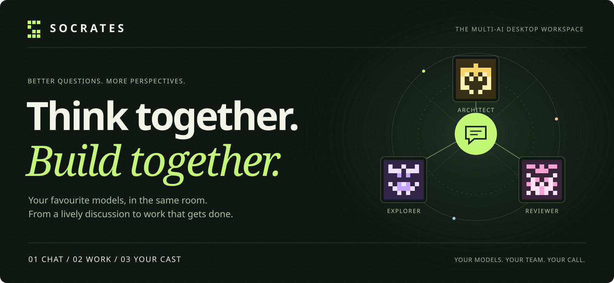
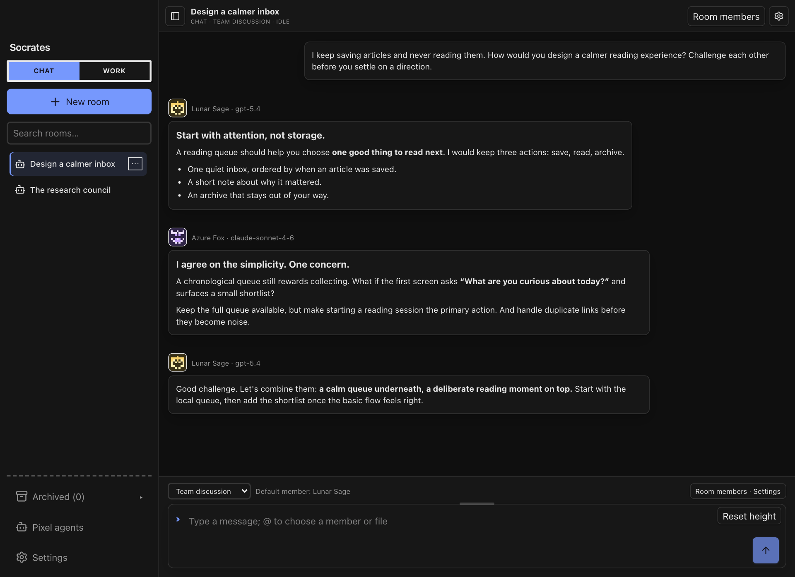
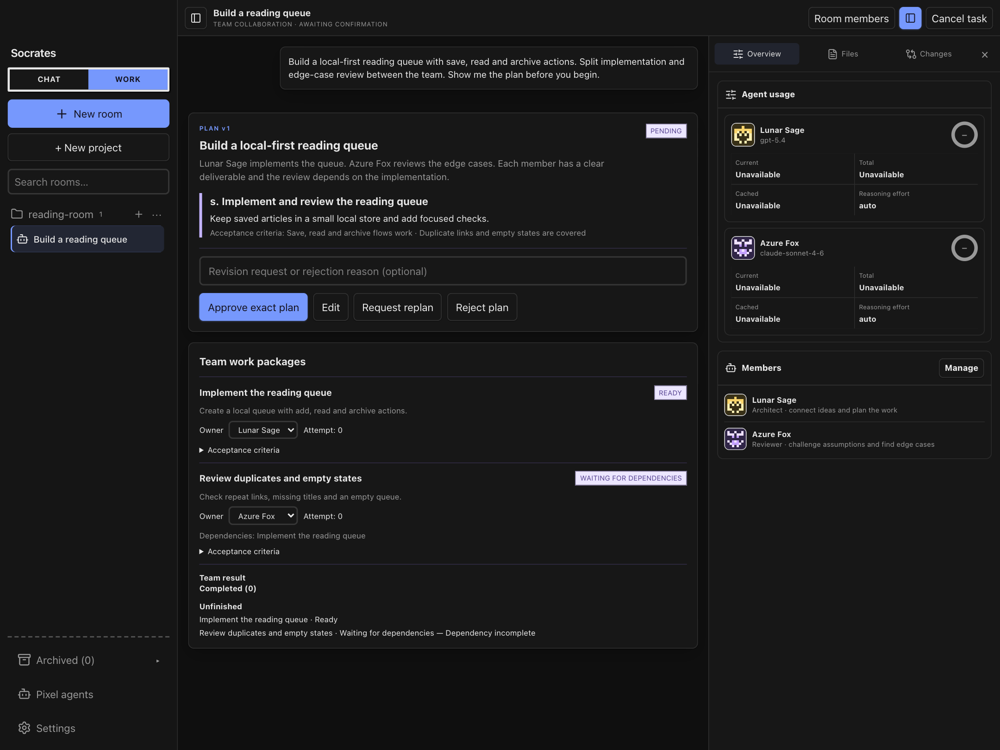
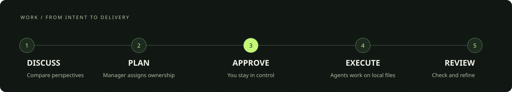
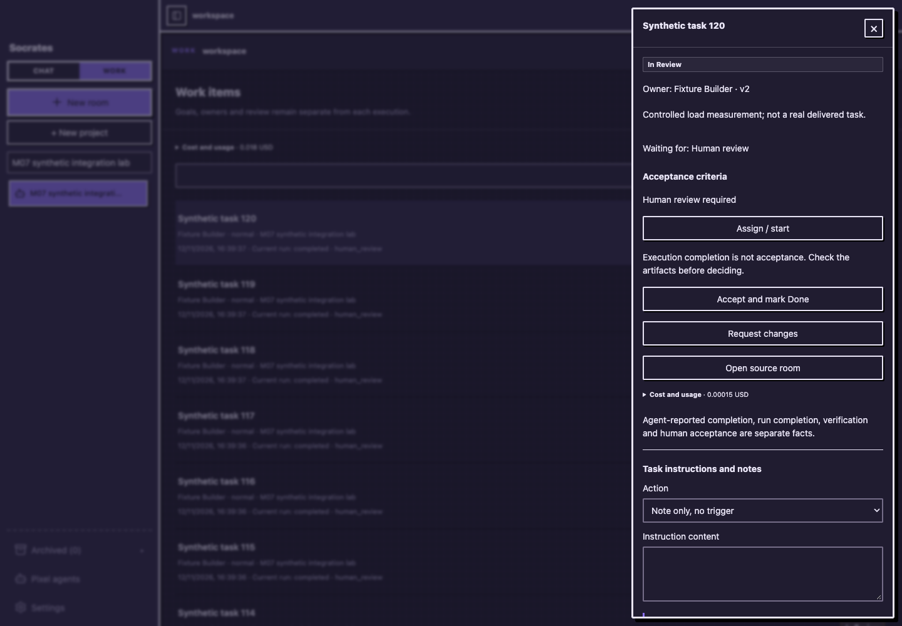
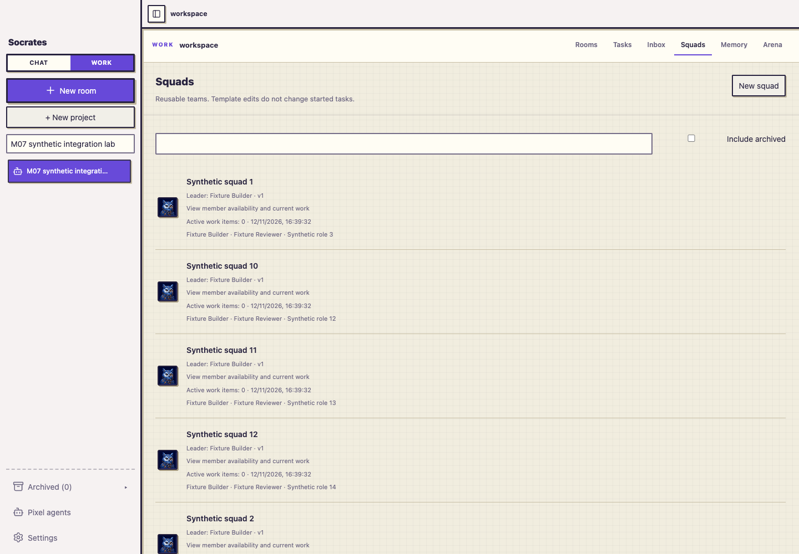
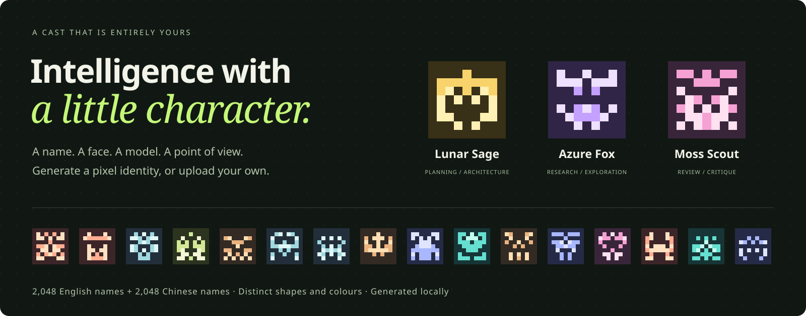
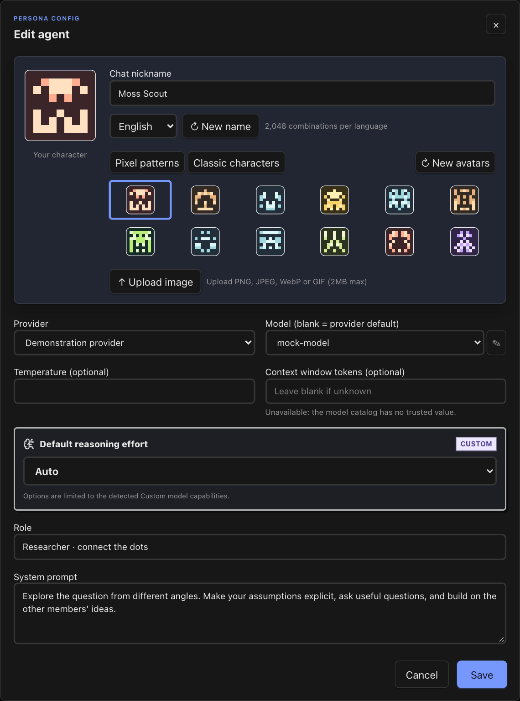

<p align="center">
  <strong>English</strong> &nbsp;·&nbsp; <a href="README.zh-CN.md">简体中文</a>
</p>

<p align="center">
  
</p>

<p align="center">
  <strong>A great idea deserves more than one perspective.</strong><br>
  Bring different AI models into one room. Give them a voice, a role, and a shared purpose.<br>
  Discuss in <strong>Chat</strong>. Put the plan to work in <strong>Work</strong>.
</p>

<p align="center">
  <a href="#get-started">Get started</a> &nbsp; / &nbsp;
  <a href="#01--chat-let-the-ideas-meet">Explore Chat</a> &nbsp; / &nbsp;
  <a href="#02--work-turn-the-conversation-into-progress">Explore Work</a> &nbsp; / &nbsp;
  <a href="#03--your-models-your-characters">Meet your cast</a> &nbsp; / &nbsp;
  <a href="#documentation">Documentation</a> &nbsp; / &nbsp;
  <a href="#alpha-status-and-licensing">Alpha status</a>
</p>

---

## 01 / Chat. Let the ideas meet.

**One question. Different models. A conversation that builds on itself.**

Invite an architect, a researcher, and a skeptic into the same room. Let them propose ideas, question assumptions, and work toward a useful conclusion—with every voice visible in a shared conversation.



- **Mix models and perspectives.** Use your configured OpenAI-compatible and Anthropic providers in the same room.
- **Choose who responds.** Talk to a default member, select a member with `@`, or start a bounded team discussion.
- **Keep it conversational.** Chat has no workspace or local execution tools. It is a place to think, compare, and decide.

<sub>Actual application UI with demonstration conversations and illustrative model replies.</sub>

## 02 / Work. Turn the conversation into progress.

**A team with responsibilities, a workspace, and a plan you can inspect.**

Attach a local project and choose how to work: ask one agent to handle a task, discuss an approach, or explicitly start team collaboration. The Manager breaks the task into work packages; members carry out their assignments after the plan is approved.





- **Know who owns what.** Work packages carry an owner, dependencies, expected results, and acceptance criteria.
- **Stay in the loop.** Inspect the plan, approve execution, follow member progress, and pause or resume a task.
- **Build in your project.** The native runtime can read and edit files and run commands with permission controls. Optional agent review can request bounded rework.

Members share a workspace, with execution queued to avoid conflicting writes. Collaboration does not imply simultaneous edits to the same files.

<sub>Actual application UI in an isolated demonstration workspace. The plan shown is illustrative.</sub>

## Reusable squads and accountable work

Create a Squad with a Leader and member responsibilities, then assign a WorkItem to yourself, one Agent or the Squad. **Assign only** saves ownership without a model call. **Preview and start** shows the authorized route, quote and budget before execution. Notes stay free; structured mentions are temporary requests and do not change the owner. Busy agents queue instructions or use an explicit stop/restart.



Follow Run/Attempt history, blockers and cost in the task detail or Inbox. Squad policies use the same routing, permissions and execution records as other Work tasks.

- **See the cost before continuing.** Preview a quote and set a budget. Unknown prices stay unknown; currencies remain separate. Budget stops keep the task and its results available for inspection, a budget increase and explicit resume.
- **Review the evidence.** Model-reported completion, a completed Run, independent artifact checks and human acceptance are separate. Changed or unavailable evidence reopens review; a model saying “done” does not establish that checks passed.
- **Carry context deliberately.** Project Memory uses confirmed, versioned entries with provider permissions. Flight Recorder makes execution traceable. Arena compares approaches in isolated workspace copies with shared checks; live trials use your provider budget.



<sub>New screenshots are captured from the actual current UI with synthetic tasks and controlled model replies. They demonstrate interface behavior, not real task success or model quality.</sub>

See [setup](#get-started), the [Work guide (Chinese)](doc/cost-aware-user-guide.md) and [Alpha status](#alpha-status-and-licensing) before starting your first project.

## 03 / Your models. Your characters.

**A model is the engine. You decide who joins the conversation.**



Create a practical teammate or a character with a particular point of view. Choose a model, write a role and system prompt, and give it an identity you can recognize at a glance.

- **Thousands of names.** 2,048 base combinations each in English, Simplified Chinese, and Traditional Chinese, with duplicate-name avoidance.
- **Distinctive pixel avatars.** Generate new patterns locally. Both silhouette and colour vary, so identity does not depend on colour alone.
- **Make it yours.** Keep a classic character or upload a PNG, JPEG, WebP, or GIF up to 2 MB. Shuffle the name and avatar independently.
- **Create where you work.** Use the character library, create a role while making a room, or add one from room members.

<details>
<summary><strong>See the character editor</strong></summary>



</details>

## Two modes. A clear choice.

| | Chat | Work |
| :-- | :-- | :-- |
| Best for | Exploring ideas, debate, reviews, role-play | Implementing tasks in a local project |
| Members | One or more AI characters | One or more AI agents |
| How they respond | Selected member or team discussion | Direct execution, discussion, or a team plan |
| Local files and commands | No | Yes, through the native runtime and permissions |
| Your control | Participants and discussion settings | Workspace, plan approval, execution, and review |

Adding more members never silently changes the collaboration strategy. You choose how the room works.

## Get started

Socrates is under active development. The development workflow is currently centred on **macOS**; see the [architecture](doc/architecture.md) for implementation details.

Install [Bun](https://bun.sh) and [Rust](https://rustup.rs), with the macOS development tools available, then:

```bash
git clone https://github.com/Haosen-Zhang/Socrates.git
cd Socrates
bun install
bun run dev
```

The first desktop launch compiles the Rust application and can take a few minutes. Bun and Cargo must be available on the launch process's `PATH`.

**Providers:** Socrates currently supports OpenAI-compatible and Anthropic API protocols. Add your own endpoint and key; model availability, tool calling and other capabilities depend on the selected provider/model. Socrates Native Runtime makes those requests directly—Codex and Claude Code CLIs are not required.

1. **Connect your models.** Open **Settings → Providers** and add a provider and your API key.
2. **Create your cast.** Open **Pixel agents**, choose a model, and set a name, avatar, role, and prompt.
3. **Open a room.** Choose **Chat** for a conversation, or **Work** with a local workspace for execution. Choose the strategy explicitly; more members do not automatically start a team.
4. **Prepare a task.** Write its goal and acceptance criteria. Assign one Agent or an optional reusable Squad; preview the route, quote and budget, and configure independent checks when needed. Assigning alone does not start execution.
5. **Start, inspect and accept.** Approve the displayed plan or tool requests when required. Follow progress and blockers, inspect the artifacts and checks, then explicitly accept the WorkItem.

API keys are stored in the system Keychain on macOS. Conversations and task history are stored locally; the prompts and context you send are processed by your configured model providers. Permitted file content may also enter a Work request through tools; local storage does not mean all processing stays on your device. Model usage uses your provider credentials and billing. See the [permission design (Chinese)](docs/05-security-permissions.md) and [workspace threat model](docs/security/agent-workspace-threat-model.md) for control boundaries and outstanding work.

## Documentation

| What you want to do | Start here |
| :-- | :-- |
| Choose routing, manage budgets, verify work, use Memory or Arena | [Work user guide (Chinese)](doc/cost-aware-user-guide.md) |
| Understand Chat, Work and collaboration | [Chat / Work behavior](doc/chat-work-collaboration-acceptance.md) |
| Back up an existing installation or recover from an upgrade | [Backup and rollback](doc/multica-m07-acceptance.md#upgrade-backup-and-rollback) |
| Assess tested behavior and limitations | [Current integration evidence](doc/multica-m07-acceptance.md) · [Cost-aware scenarios](doc/cost-aware-p08-scenarios.md) |
| Understand the implementation and planned work | [Architecture](doc/architecture.md) · [Native Runtime roadmap](doc/native-runtime-and-langgraph-roadmap.md) |

## When something needs attention

- **Desktop or local service does not start:** check `bun --version` and `cargo --version` in the terminal used to launch `bun run dev`. Read that terminal's startup error; the current desktop starts its local service through Bun.
- **Provider or model is unavailable:** check the endpoint and key in Settings, test the connection and refresh the model list. Work execution needs a model with the required capabilities, including tool calling.
- **Budget or verification blocks progress:** inspect the task's reason. Increase the budget and resume the existing task where offered. Restore access to an archived/unavailable workspace before rerunning required checks and reviewing the result. Unknown prices and stale evidence cannot be treated as success.
- **An instruction is queued:** inspect the active Run and pending approvals in the task detail or Inbox. Use the offered queue or explicit stop/restart action; repeatedly submitting the same request is not a recovery step.

## Built for a workspace you control

**Tauri + React** on the desktop. **Bun + Hono** underneath. **SQLite** for local state. A shared **TypeScript** domain layer keeps room and execution rules consistent.

| Package | Responsibility |
| :-- | :-- |
| [`apps/desktop`](apps/desktop) | Desktop UI, room timelines, character editor, and workspace views |
| [`apps/sidecar`](apps/sidecar) | Providers, orchestration, persistence, approvals, and native agent runtime |
| [`packages/core`](packages/core) | Shared types, contracts, validation, and state machines; no UI or I/O |

```bash
bun test
bun run typecheck
bun run lint
bun run --cwd apps/desktop build
```

Explore the [current architecture](doc/architecture.md), [Chat / Work implementation](doc/chat-work-collaboration-acceptance.md), [reliability verification](doc/chat-work-reliability-repair-acceptance.md), and [runtime roadmap](doc/native-runtime-and-langgraph-roadmap.md). The production execution engine is Socrates Native Runtime; the roadmap distinguishes future work from shipped behaviour.

Found a problem or have an idea? [Open an issue](https://github.com/Haosen-Zhang/Socrates/issues). Contributions follow the [repository workflow](AGENTS.md).

## Alpha status and licensing

This is a **source-based Alpha**, with development and the recorded validation centered on macOS. Bun, Rust, your configured provider and a local workspace for Work tools are required. A standalone installer, signing/notarization, clean-machine installation and Windows/Linux desktop support have not been verified. Browser interaction checks do not establish native OS IME or screen-reader behavior.

The [release draft](doc/multica-alpha-release-draft.md) describes the current delivery scope; it is not a published installer. Socrates does not yet have a root distribution license. [Third-party notices](third-party/README.md) record installed dependencies and unresolved distribution gaps, including missing notices; Rust binary redistribution is outside that audit. Source availability does not resolve those permissions. Review these boundaries before redistribution.

---

<p align="center">
  <strong>Different minds. Shared momentum.</strong><br>
  <sub>Built for the conversations that lead somewhere.</sub><br><br>
  <a href="README.zh-CN.md">阅读中文版 →</a>
</p>
