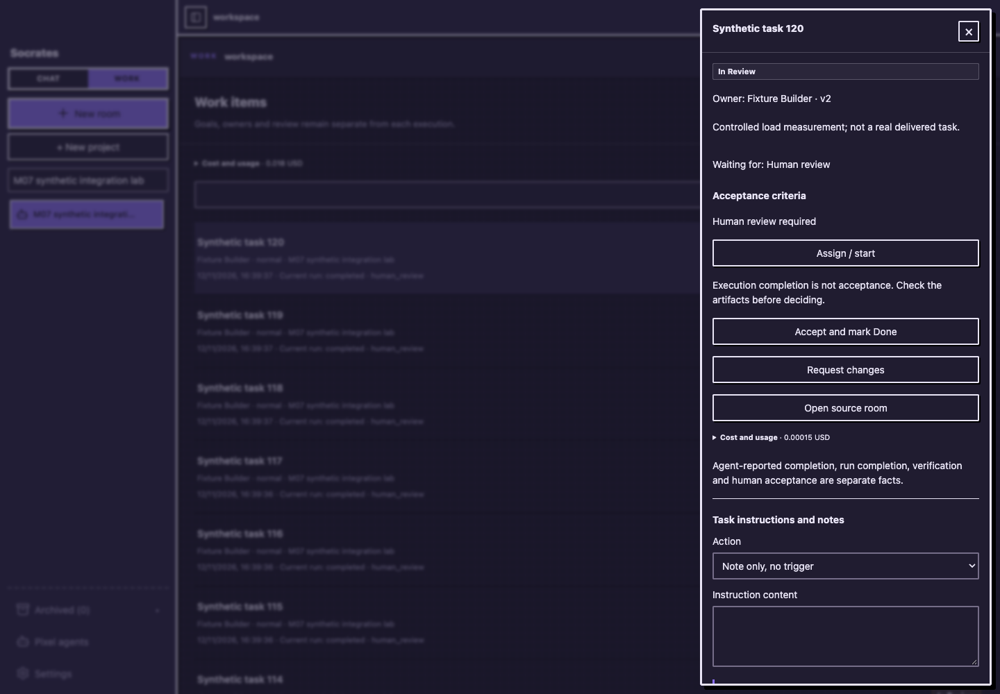
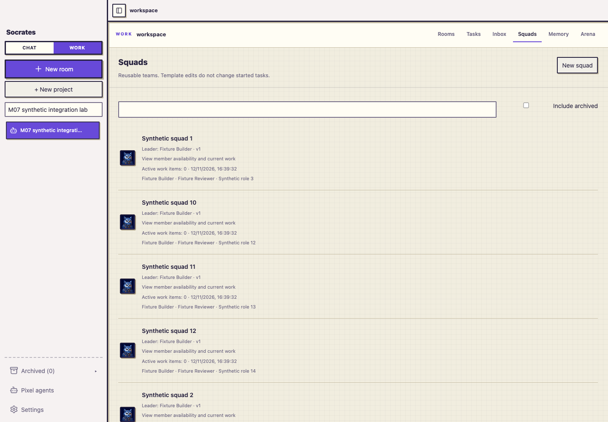

<p align="center">
  <a href="README.md">English</a> &nbsp;·&nbsp; <strong>简体中文</strong>
</p>

<p align="center">
  
</p>

<p align="center">
  <strong>一个好想法，值得听见不同的声音。</strong><br>
  把不同厂商的 AI 请进同一个房间，为它们赋予身份、角色和共同目标。<br>
  在 <strong>Chat</strong> 中碰撞观点，在 <strong>Work</strong> 中把想法变成成果。
</p>

<p align="center">
  <a href="#开始使用">开始使用</a> &nbsp; / &nbsp;
  <a href="#01--chat让观点相遇">探索 Chat</a> &nbsp; / &nbsp;
  <a href="#02--work让讨论走向行动">探索 Work</a> &nbsp; / &nbsp;
  <a href="#03--你的模型你的角色">创建你的角色</a> &nbsp; / &nbsp;
  <a href="#使用文档">使用文档</a> &nbsp; / &nbsp;
  <a href="#alpha-状态与许可">Alpha 状态</a>
</p>

---

## 01 / Chat。让观点相遇。

**同一个问题，不同的模型，一场彼此接得住的讨论。**

请一位架构师、一位研究者和一位质疑者加入房间。让它们提出方案、挑战假设、补充细节，在共同的对话中形成更完整的判断。每个观点都有清楚的身份，每个成员的声音都能被看见。


- **不同模型，同桌讨论。** 将已配置的 OpenAI 兼容供应商和 Anthropic 模型组合进一个房间。
- **由你决定谁来回应。** 交给默认成员，通过 `@` 选择指定成员，或发起有轮数边界的团队讨论。
- **专注交流与思考。** Chat 不绑定工作区，也没有本地执行工具，适合头脑风暴、方案比较与角色对话。

<sub>截图为真实应用界面，展示内容使用演示对话与示例模型回复。</sub>

## 02 / Work。让讨论走向行动。

**有分工、有工作区，也有你能看懂和确认的执行计划。**

连接本地项目，选择适合的工作方式：让一位 Agent 直接处理任务、先讨论思路，或明确启动团队协作。Manager 将任务拆成工作包，成员在计划获批后按分工执行。


- **谁负责什么，一目了然。** 每个工作包都有负责人、依赖关系、预期结果和验收条件。
- **关键步骤由你掌握。** 查看计划、批准执行、跟踪成员进度，并在需要时暂停或恢复任务。
- **直接在你的项目里工作。** Native Runtime 支持读取和修改文件、执行命令，并提供权限控制。可选的 Agent 审核能要求有次数上限的返工。

成员共享工作区，执行会排队以避免写入冲突；多 Agent 协作不代表同时修改相同文件。

<sub>截图来自隔离的演示工作区，所展示的任务计划为示例。</sub>

## 可复用的 Squad，与可验收的工作事项

创建含 Leader 和成员职责的 Squad，再把工作事项分配给本机用户、单个 Agent 或 Squad。**只分配**仅保存负责人，不调用模型；**预览并开始**在执行前显示实际路径、报价和预算。仅备注不调用模型；结构化提及是临时请求，不改变负责人。运行中的指示进入持久队列，或通过明确的停止后重启处理。



在任务详情和 Inbox 查看 Run/Attempt 历史、阻碍、费用和产物证据。Squad 策略沿用其他 Work 任务的路由、权限与执行记录。

- **继续之前看清费用。** 预览报价并设置预算。未知价格保持未知，不同币种分列；预算暂停后仍能查看任务与已有结果，加额后明确恢复。
- **按证据验收。** 模型声称完成、Run 结束、独立产物检查和人工验收分别记录。证据变更或无法读取时重新审核，模型说“完成”不等于检查通过。
- **有意识地共享上下文。** 项目记忆使用已确认、有版本及 Provider 授权的条目；Flight Recorder 保留执行线索。Arena 在独立工作区副本中用共同检查比较方案，真实模型实验会消耗你的供应商预算。



<sub>新增截图来自当前真实界面，任务与模型回复为受控合成数据；截图不代表真实项目成功或模型质量。</sub>

开始首个项目前，请阅读[启动步骤](#开始使用)、[Work 使用指南](doc/cost-aware-user-guide.md)和 [Alpha 状态](#alpha-状态与许可)。

## 03 / 你的模型。你的角色。

**模型提供能力，而你决定它以怎样的身份加入讨论。**


它可以是严谨的审阅者、擅长发散的研究伙伴，也可以是你亲手设定的角色。选择模型、编写角色与系统提示，再为它配上一个一眼就能认出的名字和头像。

- **名字不再只有几个。** 英文、简体中文、繁体中文各有 2,048 种基础组合，自动避开已使用的昵称。
- **大量可辨识的像素头像。** 在本地生成不同图案，轮廓和配色同时变化，区分成员不只依靠颜色。
- **保留你自己的风格。** 选择经典角色，或上传不超过 2 MB 的 PNG、JPEG、WebP、GIF。名字和头像可以分别随机。
- **在需要时创建角色。** 角色库、创建房间和房间成员管理中都可以使用同一个角色编辑器。

<details>
<summary><strong>看看角色编辑器</strong></summary>


</details>

## 两种模式，清楚的选择。

| | Chat | Work |
| :-- | :-- | :-- |
| 适合做什么 | 探索想法、辩论、评议、角色对话 | 在本地项目中完成具体任务 |
| 成员 | 一位或多位 AI 角色 | 一位或多位 AI Agent |
| 如何回应 | 指定成员或团队讨论 | 直接执行、讨论或团队计划 |
| 本地文件与命令 | 不提供 | 通过 Native Runtime 和权限控制使用 |
| 你掌握什么 | 参与成员与讨论设置 | 工作区、计划审批、执行与审核 |

增加成员不会自动改变协作策略。房间如何工作，始终由你明确选择。

## 开始使用

Socrates 正在持续开发中，目前的开发流程以 **macOS** 为主。实现细节见[架构文档](doc/architecture.md)。

安装 [Bun](https://bun.sh)、[Rust](https://rustup.rs)，并准备好 macOS 开发工具，然后运行：

```bash
git clone https://github.com/Haosen-Zhang/Socrates.git
cd Socrates
bun install
bun run dev
```

首次启动桌面端需要编译 Rust，可能耗时几分钟。启动进程的 `PATH` 中需要能找到 Bun 和 Cargo。

**模型供应商：** 当前支持 OpenAI 兼容与 Anthropic API 协议。使用自己的端点和 API Key；模型可用性、工具调用及其他能力取决于所选供应商和模型。Socrates Native Runtime 直接发起请求，不需要 Codex 或 Claude Code CLI。

1. **连接模型。** 打开「设置 → 模型供应商」，添加供应商和自己的 API Key。
2. **组建角色阵容。** 打开角色库，选择模型，设置名字、头像、角色与系统提示。
3. **创建房间。** 选择 Chat 开始交流；需要执行时，选择 Work 并绑定本地工作区。明确选择协作策略，增加成员不会自动启动团队。
4. **准备任务。** 写明目标与验收条件，分配给单个 Agent 或可选的复用 Squad；预览执行路径、报价和预算，按需配置独立检查。只分配不会启动执行。
5. **启动、检查、验收。** 按界面要求批准计划或工具请求，跟踪进度与阻碍，查看产物和检查结果，最后明确验收工作事项。

macOS 上的 API Key 存在系统 Keychain 中。对话与任务历史保存在本地；你发送的提示和上下文会交给所配置的模型供应商处理，经授权的文件内容也可能通过工具进入 Work 请求，本地保存不等于全部处理都在本机完成。模型调用使用你的供应商凭证与计费额度。[权限设计](docs/05-security-permissions.md)和[工作区威胁模型](docs/security/agent-workspace-threat-model.md)说明控制边界及待完成事项。

## 使用文档

| 你想完成什么 | 从这里开始 |
| :-- | :-- |
| 选择路由、管理预算、验证成果，使用记忆或 Arena | [Work 使用指南](doc/cost-aware-user-guide.md) |
| 理解 Chat、Work 与协作行为 | [Chat / Work 说明](doc/chat-work-collaboration-acceptance.md) |
| 备份现有数据或从升级问题中恢复 | [备份与回退](doc/multica-m07-acceptance.md#upgrade-backup-and-rollback) |
| 了解已验证的行为与限制 | [本轮集成证据](doc/multica-m07-acceptance.md) · [成本感知场景](doc/cost-aware-p08-scenarios.md) |
| 理解实现和后续计划 | [架构](doc/architecture.md) · [Native Runtime 路线](doc/native-runtime-and-langgraph-roadmap.md) |

## 遇到问题时

- **桌面端或本地服务未启动：** 在运行 `bun run dev` 的终端中检查 `bun --version`、`cargo --version`，并查看该终端的启动报错。当前桌面端通过 Bun 启动本地服务。
- **供应商或模型不可用：** 在设置中检查端点与 Key，测试连接并刷新模型列表。Work 执行需要模型具备所需能力，包括工具调用。
- **预算或验证阻止继续：** 查看任务中的具体原因，通过已有入口加额并恢复原任务。先恢复归档或不可用工作区的访问，再重跑必要检查并审核结果；不能把未知费用或过期证据当成成功。
- **指示正在排队：** 在任务详情或 Inbox 查看活动 Run 和待审批事项，使用界面提供的排队或明确停止后重启操作；重复提交同一请求并不是恢复步骤。

## 为你掌握的工作区而构建。

**Tauri + React** 提供桌面界面，**Bun + Hono** 承载应用服务，**SQLite** 保存本地状态，共享的 **TypeScript** 领域层统一房间和执行规则。

| 包 | 职责 |
| :-- | :-- |
| [`apps/desktop`](apps/desktop) | 桌面界面、房间时间线、角色编辑器与工作区视图 |
| [`apps/sidecar`](apps/sidecar) | 供应商、编排、持久化、审批与原生 Agent 运行时 |
| [`packages/core`](packages/core) | 共享类型、契约、校验与状态机；无 UI 和 I/O 依赖 |

```bash
bun test
bun run typecheck
bun run lint
bun run --cwd apps/desktop build
```

进一步阅读：[当前架构](doc/architecture.md)、[Chat / Work 实现](doc/chat-work-collaboration-acceptance.md)、[可靠性验证](doc/chat-work-reliability-repair-acceptance.md)、[运行时演进路线](doc/native-runtime-and-langgraph-roadmap.md)。生产执行内核为 Socrates Native Runtime；路线文档区分已实现能力和后续计划。

遇到问题或有新的想法？欢迎[创建 Issue](https://github.com/Haosen-Zhang/Socrates/issues)。贡献代码请遵循[仓库开发流程](AGENTS.md)。

## Alpha 状态与许可

当前为**从源码运行的 Alpha**，开发与已记录验证以 macOS 为主。需要 Bun、Rust、自己配置的供应商，以及用于 Work 工具的本地工作区。独立安装包、签名与公证、全新机器安装及 Windows/Linux 桌面支持尚未验证。浏览器交互检查不能证明原生中文输入法候选窗口或屏幕阅读器行为。

[发行说明草稿](doc/multica-alpha-release-draft.md)描述当前交付范围，不代表已发布安装包。Socrates 尚无根目录分发许可证；[第三方声明](third-party/README.md)记录实际安装依赖及缺失声明等分发缺口，Rust 二进制再分发不在该审计范围内。源码可访问不等于这些许可问题已经解决，再分发前请核对相关边界。

---

<p align="center">
  <strong>不同的智慧，共同向前。</strong><br>
  <sub>为那些值得继续的讨论而做。</sub><br><br>
  <a href="README.md">Read in English →</a>
</p>
