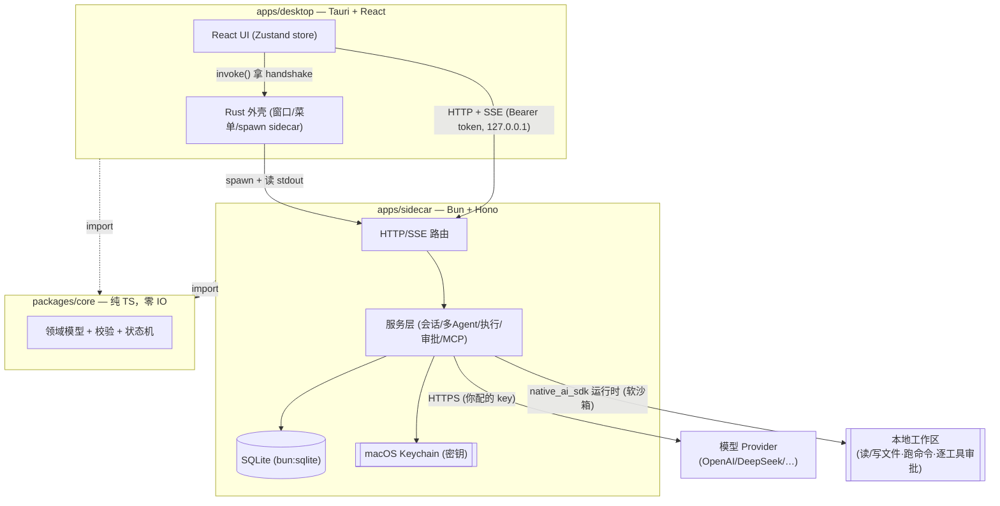
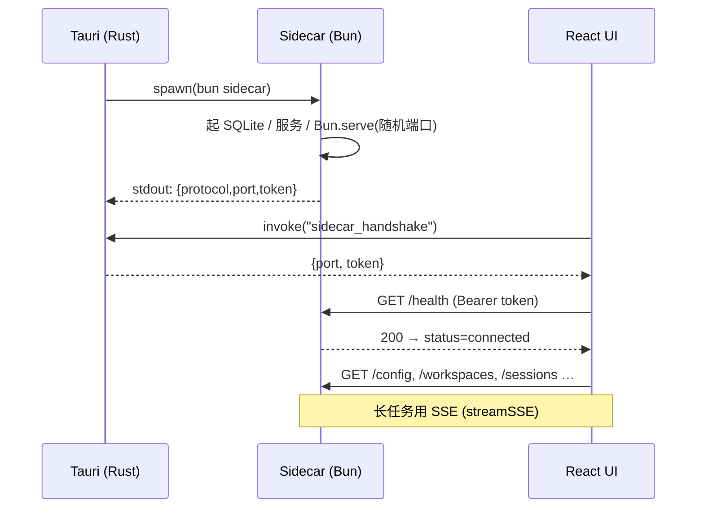
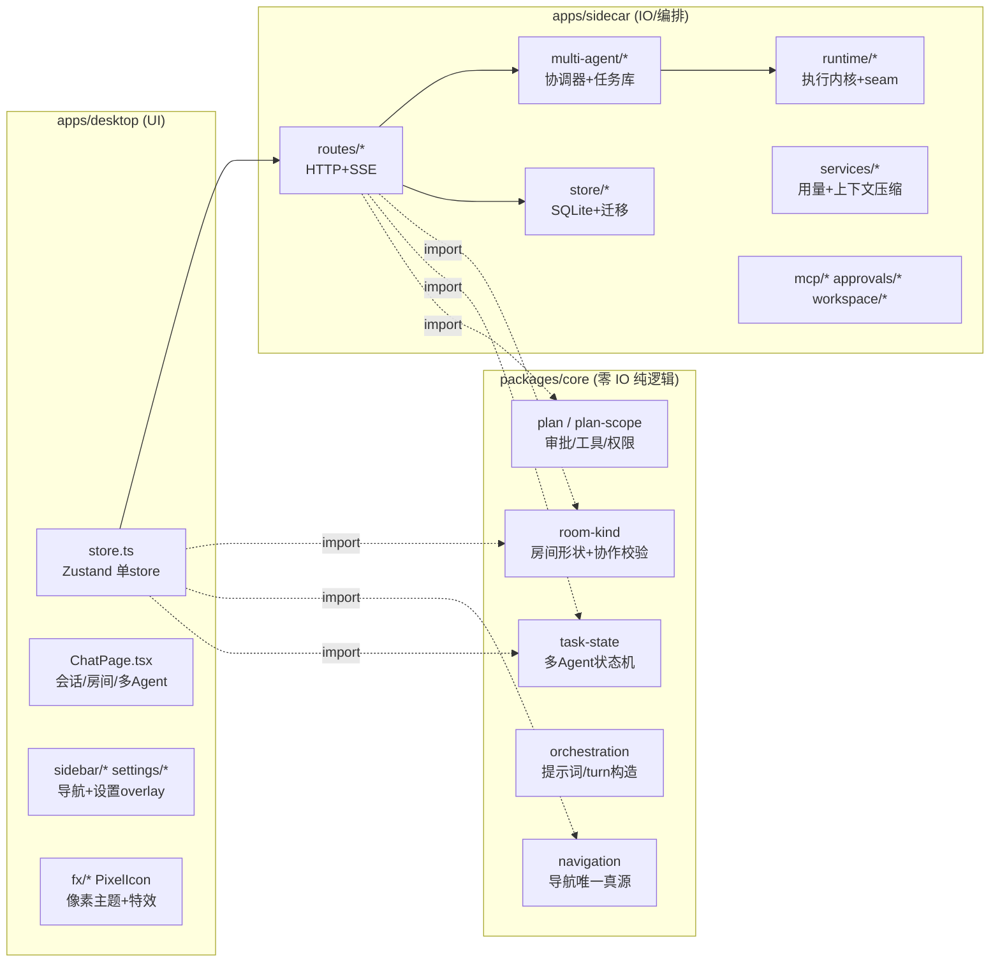
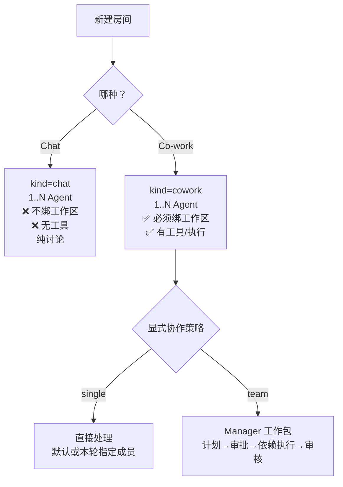
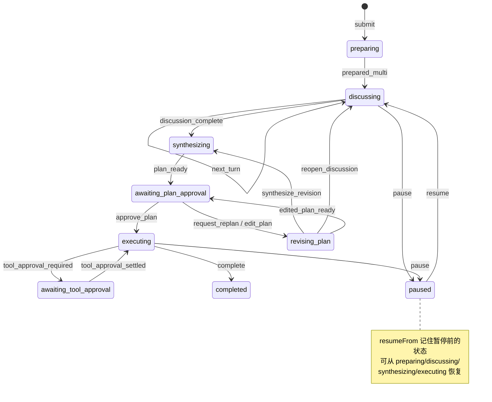
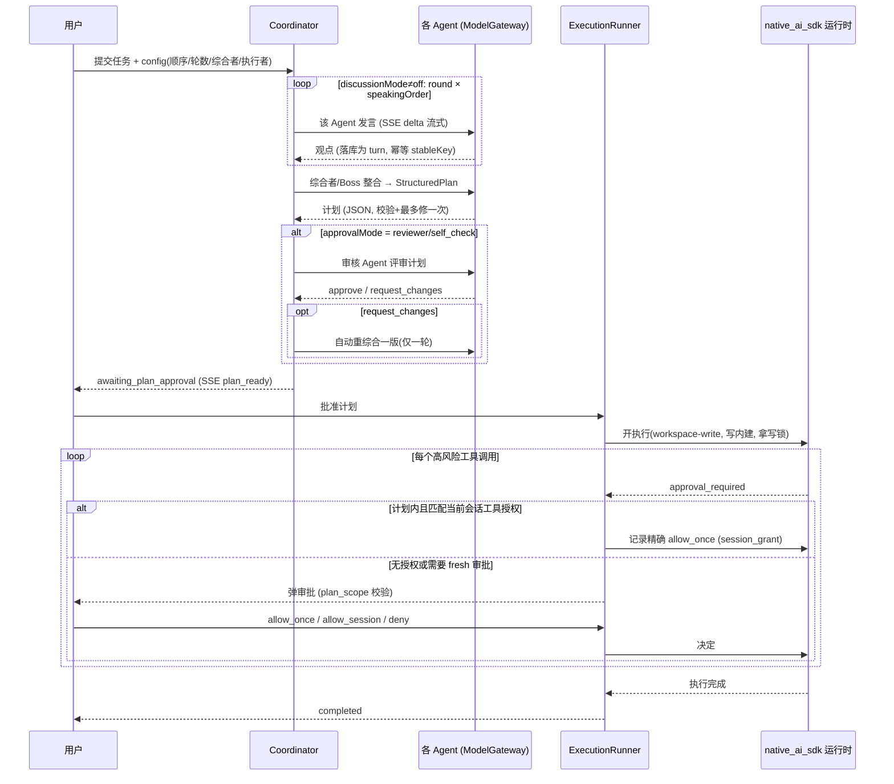
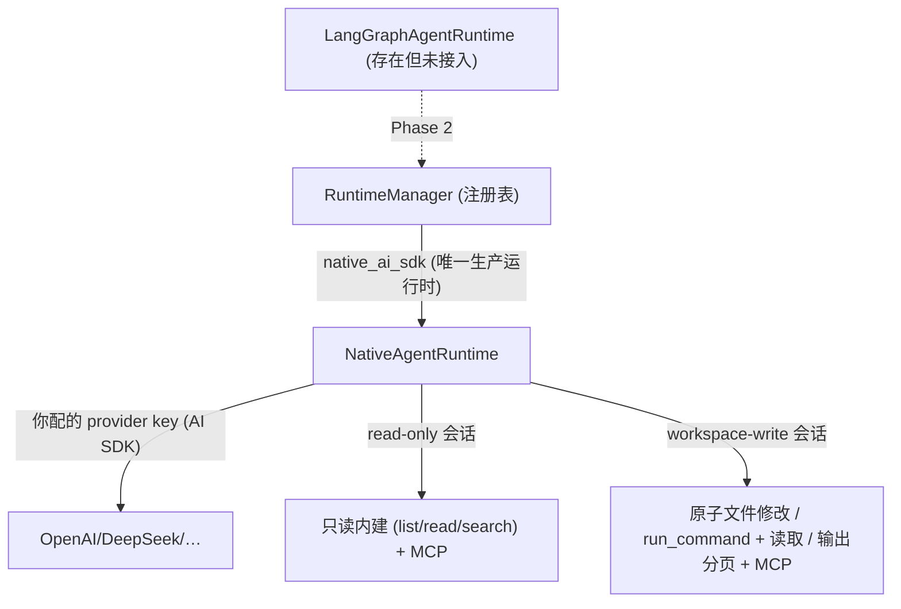
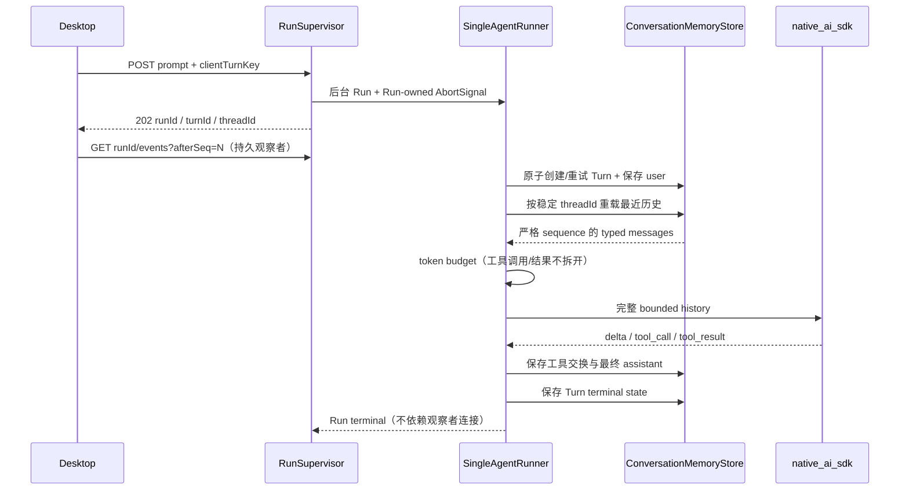

# Socrates 软件架构总览

> 2026-11-11：M02–M03 新增项目 Squad 与独立 WorkItem。模板、冻结房间绑定、持续负责人、单次执行及人工审核分别持久化；只分配不启动，显式启动复用原 RoomCommandService/Coordinator/Native，详见 [实现与验收](multica-m02-m03-acceptance.md)。

> 2026-11-11：P08 增加数据库写入前兼容检查、版本化工作流恢复边界及新任务准入开关；使用与备份说明见 [使用指南](cost-aware-user-guide.md)，本轮可复验场景见 [P08 证据](cost-aware-p08-scenarios.md)。

> 2026-11-08 增补：P05 [本地执行记录](cost-aware-flight-recorder.md)、P06 [项目记忆](cost-aware-project-memory.md) 和 P07 [Arena](cost-aware-arena.md) 已接入项目入口及 sidecar。记录为只读业务投影；记忆在命令时冻结并在每次请求复核授权；Arena 复用原任务入口、预算、Native 工具循环及独立验证。迁移 029–033 只追加新领域表，原房间/历史/账本保留。

> 2026-11-08 增补：P03 真实产物验收与 P04 成本路由已接生产。Work 选择自动预设/Custom 后由持久 LangGraph 父工作流调度现有 Native/Team 子执行器；旧 single/team 与 Chat 保持原路径。冻结决策、状态与权限边界见 [成本路由与验证](cost-aware-routing.md)。

> 事无巨细版：从进程拓扑、前端 UI 策略，到运行时骨架、房间/多 Agent 编排、执行内核与安全边界。
> 描述当前实现。2026-11-05 更新：Chat / Work、结构化房间命令与持久工作包已接通；房间异步归属、历史版本、团队实时事件和回退生命周期修复见 [可靠性验收](chat-work-reliability-repair-acceptance.md)。初版验收见 [本轮验收](chat-work-collaboration-acceptance.md)。
> 2026-11-06：P00–P02 新增统一逐调用费用账本、连接级价格快照、任务报价与美元预算暂停/增额/恢复；当前验证与限制见 [implementation-progress.md](../implementation-progress.md)，权威边界见 [ADR 0009](../docs/adr/0009-model-invocation-cost-and-budget-authority.md)。

---

## 0. 一句话概括

Socrates 是一个**多模型群聊 + 本地协作**的桌面 Agent 工作台：
- **外壳**：Tauri（Rust）+ React 19 + Vite + Tailwind + Zustand。
- **大脑/IO**：一个 Bun 进程（sidecar），跑 Hono HTTP/SSE 服务，管所有状态、模型调用、执行。
- **执行内核**：Socrates 自研的 **`native_ai_sdk` 运行时**——用**你配的 provider key** 驱动模型循环调用工具（读/写文件、跑命令），逐工具审批。（Codex 依赖已在 #77 移除。）统一 `AgentRuntime` 接口做 seam，可再接 LangGraph/其它。
- **纯逻辑**：`packages/core` 是零 IO 的领域层，前后端共享同一份判断（房间形状、导航、状态机、审批规则）。

三层 monorepo（Bun workspaces）：



---

## 1. 进程拓扑与握手（怎么跑起来的）

### 1.1 启动链路

1. Tauri（Rust 外壳）作为**父进程**，`spawn` 一个 Bun 子进程运行 sidecar。
2. sidecar 随机分配端口、生成一次性 `token`（`crypto.randomUUID()`），把握手信息以**单行 JSON** 打到 stdout：
   ```json
   { "protocol": "socrates-sidecar/1", "port": 53211, "token": "…" }
   ```
   协议定义在 `packages/core/src/handshake.ts`，字段变更必须升版本号。
3. Rust 读到这行，解析后通过 Tauri command 暴露给前端。
4. React store 的 `connect()` 调 `invoke("sidecar_handshake")` 拿到 `{port, token}`，先打 `/health` 确认，再把 `status` 置为 `connected`。

### 1.2 之后所有通信

- 前端所有请求走 `sidecarFetch(hs, path)`：`http://127.0.0.1:<port>` + `Authorization: Bearer <token>`（`store.ts`）。
- sidecar 用 `Bun.serve({ idleTimeout: 0 })` —— **0 是故意的**，否则默认 10s 空闲超时会掐断推理模型的长流。
- 中间件双重闸门（`security/loopback.ts`）：只接受**回环 host** + **合法 renderer origin**，否则 403。
- **孤儿进程防护**：sidecar 每 2s 检查 `process.ppid === 1`（父进程没了会被 init 收养），一旦发现就优雅关停自己，避免占着端口。



---

## 2. 分层与依赖



**关键原则**：`core` 不碰任何 IO，前后端都 import 它。房间合不合法、导航目标合不合法、状态能不能转移——**同一份判断**，UI 不自己推断、后端兜底。

---

## 3. 前端（apps/desktop）

技术栈：**Tauri 2 + React 19 + Vite 7 + Tailwind 4 + Zustand 5**。像素风 UI + 8-bit 音效 + WAAPI 粒子特效。

### 3.1 状态管理与性能策略（P0 的核心）

单一 Zustand store（`store.ts`）持有所有状态。性能的关键是**订阅边界**（`selectors.ts`）：

- 组件只通过 `useStorePick(...keys)` = `useStore(useShallow(pick(...keys)))` 订阅**自己声明的字段**。
- `HIGH_FREQUENCY_KEYS`（`streaming`/`messages`/`agentEvents`/`currentMultiTask`/`usageSummaries`…）是每帧/每事件级更新的字段。受保护组件（设置、供应商、MCP、侧栏）的订阅清单被测试断言**与高频字段零交集**——所以流式 delta 不会重渲染这些无关组件。

流式渲染的三道减压：
1. **SSE + rAF 批处理**：`store.sendMultiTask` 把 delta 累积，用 `requestAnimationFrame` 批量 flush，不逐 token setState。
2. **节流 Markdown**（`useThrottledValue.ts`）：流式期间不对每帧全量重解析 Markdown，最终值仍落定。
3. **列表窗口化**（`listWindow.ts`）：长会话只渲染最近 N 条（`DEFAULT_WINDOW_SIZE=80`），更早的折叠可展开。选窗口而非虚拟化——因为变高的 Markdown/代码/审批卡会破坏滚动和无障碍。

### 3.2 导航模型（顶层只有 Chat / Work）

`AppMode = "chat" | "cowork"`，由 `NavigationTarget`（`core/navigation.ts`）单一真源派生：

```
NavigationTarget =
  | { kind: "chat_room";      roomId }
  | { kind: "cowork_room";    roomId, workspaceId }
  | { kind: "cowork_workspace"; workspaceId }
```

- Chat 的前端目标不继承 workspace；SessionStore、创建/绑定路由和生产 Native factory 同时校验无 workspace、空工具能力。
- 侧栏（`sidebar/sidebarLists.ts`）按模式过滤：Chat 是扁平房间列表，Co-work 是工作区树，两者互不串场。搜索范围随模式收窄，不改任何持久化关系。
- `ModeSegmented`（`sidebar/ModeSegmented.tsx`）是真正的 tablist（roving tabindex + 方向键），滑块用 transform 位移避免重排。
- **mode 是真实状态**：跟随导航到房间时切换，但删除/归档清空选中时不弹回 chat。
- **Settings 是 overlay，不是 NavigationTarget**（`settings/settingsOverlay.ts`）：关闭后必须回到原房间，所以不能占用 primary target。单实例，`⌘,` / 左下角按钮 / macOS 菜单都只聚焦同一个。

### 3.3 会话视图

`ChatPage.tsx` 按房间 kind 和显式策略渲染，不以成员数量启动团队流程：
- Chat 与 Work 均使用 sessions；迁移 022 将旧 rooms 连同历史、作者、成员和归档状态接入统一会话。旧 ID 保留（已有 legacyRoomId 映射则沿用），旧写接口返回 canonical session 映射。
- 新 Chat：共享时间线、成员/默认回应者、指定成员或有界讨论；无工作区 Dock 和本地工具。
- Work `strategy=single`：直接 Native 执行；`strategy=team`：Manager 计划、精确审批、WorkPackage 面板与成员执行。
- `AgentEditor` 复用于角色库、建房和成员管理；`RoomComposer` 提交结构化 mentions；`RoomTimeline` 保持阅读位置；`TeamTaskPanel` 展示 owner/依赖/状态/结果。
- `store.ts` 的 roomProjections、草稿和 mentions 按 roomId 隔离。切房只切投影，不终止后台订阅。终态与重连根据持久命令/run/task 对账；两个模式分别记住选择、搜索和展开状态。

其它：Markdown 用 `MD_COMPONENTS`（`markdownLink.tsx`）安全链接——所有链接 preventDefault，http(s) 交系统浏览器，工作区相对路径不导航（防止 `[test.md](test.md)` 把 SPA 冲走）。i18n 三语（`i18n.ts`：zh-CN/zh-TW/en）。

---

## 4. 后端（apps/sidecar）

**Bun + Hono**，`index.ts` 是装配中心：建 DB、密钥库、各 Store/Manager/Runner，注册路由。

### 4.1 路由地图

| 路由 | 职责 |
| --- | --- |
| `/config` | 应用配置（主题/字号/代理/侧栏偏好） |
| `/providers` | 模型供应商 + 连接测试 + 列模型 |
| `/agents` | Agent（昵称/头像/模型/角色/系统提示） |
| `/rooms` | 群聊房间（Chat，legacy 表） |
| `/workspaces` | 工作区（本地目录）注册/归档 |
| `/sessions` | 会话（cowork 房间：single/multi agent）+ 协作设置 |
| `/agent` | 成员 Run 启动、状态、显式取消、预算继续与独立 SSE 观察 |
| `/room-commands` | 带请求 ID/结构化 mentions 的统一房间分派、持久讨论与重放 |
| `/multi` | 多 Agent 任务：讨论/计划/审批/执行（SSE 流式） |
| `/cost` | 连接级价格快照/本地目录导入、版本化报价、逐调用账目/导出、预算增额/恢复、人工账单对账 |
| `/content` | 附件/工作区文件内容 |
| `/mcp` | MCP 服务器管理 + 工具 |

SSE 用 Hono 的 `streamSSE`，事件形如 `{ event: type, data: JSON }`（见 `routes/agent-runs.ts`、`routes/multi-agent.ts`）。

### 4.2 持久化：SQLite + 版本化迁移

`bun:sqlite`，迁移在 `store/migrations/`，**版本化 + 校验和 + 幂等**：

```
001 baseline               005 mcp
002 agent_workspace        006 multi_agent
003 runtime_foundation     007 usage_and_recovery
004 p2_conversations       008 project_conversation_organization
                           009 room_kind  ← Chat/Co-work 模型迁移
                           010 phase1_runtime
                           011 conversation_memory  ← 本地 Thread/Turn 记忆
```

主要表：`providers` `agents` `workspaces` `sessions` `session_agents`
`conversation_threads` `conversation_turns` `session_messages` `message_parts`
`rooms` `multi_tasks` `multi_turns` `plan_versions` `runtime_sessions`
`usage_records` `events` `mcp_servers` `approvals` `workspace_leases`。

**密钥永不进库**：`secrets.ts`（`KeychainSecrets`）存 macOS Keychain，库里只存 `api_key_ref` 引用。

---

## 5. 房间模型（Chat vs Co-work）

领域定义在 `core/room-kind.ts`。两种房间**唯一的结构差异是工作区**：



- `validateRoomShape()`：chat 不得绑工作区、cowork 必须绑、成员唯一、至少 1 人——前端先校验，`session-store` 兜底（绕过前端也建不出坏形状）。
- **不绑已归档工作区**：`session-store.create/bindWorkspace` 拒绝 `workspace_archived`。
- legacy：`rooms` 表（群聊）一律视为 chat；`sessions` 表按旧 `mode` 推导 `kind`（迁移 009）。
- **建房入口收敛**：前端 `createRoomFromDraft` 是唯一入口，工作区只来自草稿（不再从全局 `activeWorkspace` 隐式继承——那正是"Chat 看起来继承工作区"的历史根因）。

### 5.1 协作治理设置（Co-work Room Settings）

`RoomCollaborationSettings`（持久化在 `sessions.collaboration_json`）：

| 维度 | 值 | 运行时是否已接通 |
| --- | --- | --- |
| `discussionMode` | off / round_robin / (debate) | ✅ off/round_robin 已接 |
| `collaborationMode` | single_executor / agent_directed_multi_agent(Boss) / human_directed | ✅ Boss 已接 |
| `boss` | enabled / bossAgentId / allowBossExecution | ✅ 真实生效 |
| `approvalMode` | human / executor_self_check / designated_reviewer | ✅ 真实生效 |
| `supervisionMode` | off / final_only / … | ❌ 尚未接入运行时（UI 如实标注） |

跨字段规则集中在 `validateCollaborationSettings()`，前后端共用。

### 5.2 成员管理（#78）

Co-work 房间可增/删成员（`session-store` 的 `addAgent`/`removeAgent`，路由 `POST/DELETE /sessions/:id/agents`）：
- 仅**会话空闲**时可改（`active_session_members_locked`），**至少保留一人**。
- 兼容字段 mode 按人数重算，但 strategy 独立保存。增加第二位成员仍保持 single，不启动团队循环；减少到一人会降级非法团队/讨论配置。成员 snapshot 仅在显式应用模板更新时改变，历史消息从当次运行的 authorSnapshot 读取身份与模型。
- 前端 `SessionMembersDialog`，入口在单/多 Agent 会话头部的成员按钮。

**建房入口收敛**：从侧栏工作区分组的「＋」建房会**锁定为该工作区的 Co-work**（`presetWorkspaceId`），不再让重选工作区；「选工作区」只在全局「新建房间」时开放。

---

## 6. 多 Agent 编排（协调器）— 核心

`multi-agent/coordinator.ts` + `multi-agent/task-store.ts`。状态机定义在 `core/task-state.ts`（纯 reducer，可测）。

### 6.1 任务状态机



### 6.2 一次多 Agent 任务的完整流程



### 6.3 三个要点

会话工具授权绑定房间、workspace identity、工具名称与 generation、风险和 policy version。仅明确支持的非破坏性内建写入工具可在 high 标签下接受该授权；命令、删除/移动、计划外操作和未知结果恢复仍需单次确认。迁移 025 保留旧授权事实，缺少房间/generation 的旧行不会被自动扩权。

**幂等与恢复**：每个 turn 用 `stableKey = task:attempt:phase:round:index` 落库。暂停/恢复时已完成的 turn 直接回放，不重复调模型。上下文用 `services/context-compaction.ts` 压缩。

**Boss（真实语义）**：`boss.enabled` 时由 Boss agent 整合出计划（替代配置的 synthesizer）；默认不执行，Boss 同时被指为执行者时判 `boss_must_not_execute`。

**Reviewer（真实语义）**：`executor_self_check`（执行者自审）/ `designated_reviewer`（指定人审）会**真跑一次审核 Agent**，产出 `approve`/`request_changes` 并 emit `reviewer_verdict`；request_changes 自动重综合一版（仅一轮，防死循环）后停在人工审批。审核 turn 复用同一套幂等机制（`phase=reviewing`）。

**讨论层用谁的 key**：讨论/综合/审核都走 `ModelGateway`，用你在 Socrates 里给每个 Agent 配的 provider key（`gateway({ apiKey: agent.apiKey, … })`）。

---

## 7. 运行时骨架与执行内核（seam 所在）

> **重要变更（PR #77）**：Codex 已被**整个移除**（`runtime/codex/`、`child-supervisor` 全删）。
> 执行内核现在是 Socrates 自研的 **`native_ai_sdk` 运行时**，用**你在 Socrates 里配的 provider key**
> 跑，不再依赖本机 codex 登录/额度。roadmap 里的 Phase 1（摆脱 Codex）基本达成。

### 7.1 统一接口 + 注册表

`runtime/runtime-manager.ts` 是运行时注册表：`register(kind, factory)`，按字符串 `runtimeKind` 取工厂。所有运行时都实现 `core` 的 `AgentRuntime` 接口。**生产只注册了一个**：`native_ai_sdk`。（另有一个 `LangGraphAgentRuntime` 已在代码里，但**尚未 register 进生产**，见 roadmap Phase 2。）



`native_ai_sdk` 按宿主传入的 `allowedCapabilities` 决定可用能力；生产 Co-work 工厂注册16个 Native 工具及获准的 MCP 工具，逐次调用再执行权限与审批检查：

| sandbox | 鉴权/计费 | 可用工具 |
| --- | --- | --- |
| `read-only` | **你配的 API key** | 只读内建（list/read/search）+ MCP |
| `workspace-write` | **你配的 API key** | 上面 + 8个文件修改工具、结构化 `run_command` / `run_shell` 别名、`read_tool_result`；命令及破坏性操作必须 fresh 精确人工审批 |

> **计费**：整条链路（讨论 + 执行）都走 `ModelGateway` / `native_ai_sdk`，用的是**你配的 provider key**。不再有"codex 登录额度"这回事。
>
> **写能力接线（易错点，见 #78）**：`NativeAgentRuntime.start()` 曾硬编码 `allowedCapabilities: ["workspace_read","mcp"]`，把写工具过滤掉——导致 workspace-write 却只有只读。现在由 `index.ts` 按 sandbox 传入 `allowedCapabilities`（含 `workspace_write`），写工具才到得了模型。缺省仍退回只读，绝不擅自开放写。

### 7.2 单 Agent 的本地会话记忆

`HistoryStore` 的持久公开历史是房间消息权威；`ConversationMemoryStore`
维护 SQLite 中的 Thread/Turn 与可查询消息投影。执行事实由 `ExecutionEventStore`
及同事务 SQL 投影记录，公开历史不等于全部内部执行事件：



`RunSupervisor` 是单 Agent 活跃 Run 的进程内所有者：保存执行 Promise 和每个
Run 独立的 `AbortController`。SSE/WebView 断开不能取消执行；
`POST /agent/runs/:id/cancel` 才执行显式取消。SQLite `agent_runs` 与
`runtime_events` 提供可恢复的状态和事实。事件观察端点按持久 `seq` 先重放、再等待
新提交，SSE `id` 与 `seq` 相同；Desktop 从最后确认游标重连并拒绝缺号或身份错配。

- 每个 Room 有稳定默认 Thread；新 Thread/不同 Room 的历史严格隔离。
- `sessions.primary_agent_id` 是明确落库的默认执行 Agent，不从成员顺序动态推导。
- `clientTurnKey`、输入哈希和消息 idempotency key 防止命令重放、重试和事件回放重复写入。
- 单 Agent Provider 调用禁用 AI SDK 内部重试，由 Runtime 外层执行最多 5 次的显式策略；
  只在权威文本或 Tool 活动开始前重试已分类的瞬时故障。每个模型采样建立稳定 Step，
  每次外部调用建立独立 ProviderAttempt；`step.started` / `provider.attempt.started`
  必须在调用前提交，ToolResult/审批处理完成并提交 `step.completed` 后才允许下一次采样。
  Multi-Agent Gateway 也禁用 SDK 内部重试，但暂不套用该策略。
- 单 Agent 工具在主体执行前提交 intent/checkpoint/started，输出与结果事件原子提交。
  `tool_calls` 表示逻辑操作，`tool_attempts` 表示最多 3 次安全的瞬时错误尝试；
  非幂等工具不自动重试。重启或已停止 Run 的下一轮对话会补齐公开工具历史，已开始
  却没有结果的工作区修改先按 exact operation ID、工作区身份、路径与哈希核验持久文件证据。
  确认生效可记录恢复成功，确认未发布标记取消；无法确认的操作明确标为
  `TOOL_OUTCOME_UNKNOWN`，再次修改需新审批。恢复只核验，不重放工具主体。
  成功结果提交后核验并清理操作证据及已确认的隔离残留；清理失败不撤销成功，
  启动时可重试。结果未提交时必须保留恢复证据。
  详见 [执行事件与工具恢复](../docs/07-execution-event-authority.md)。
- 上下文窗口取模型目录或用户 override 的已解析值；未知保持 unavailable，不伪造 4K 上限。
  已知窗口超限会记录 `memory.context_truncated`；当前工作单元本身超限时在调用 Provider
  前明确失败，不发送越界 payload。
- Native 输入/规范输出共用递归 schema。输出验证后持久化，再独立生成模型预览；
  语义/参数错误形成配对的失败工具结果供模型纠正，不触发非法审批或执行。
  长结果和完整 stdout/stderr 存私有 SQLite artifact，`read_tool_result` 按 Session/workspace
  限定范围分页读取。命令每流最多64MiB，超限明确终止。历史修复保留完整输出引用。
- 工具 deadline 限制单个 attempt，通过派生 AbortSignal 统一执行；超时/取消等待清理，
  未收敛的工具阻止该工作区继续 dispatch。相同工具与归一化参数连续3/5/8次仅提示模型
  检查结果或改变方法，不把基础设施 retry 当作模型重复调用。
- `write_file` 使用同目录 staging/fsync/原子发布，返回前后 SHA-256 与有界真实 diff；
  可传 `expectedSha256` 拒绝 stale 更新；新建时显式传 `null` 表示“目标必须不存在”，更新时使用 `read_file` 返回的完整哈希。哈希冲突保留文件并向模型返回具体纠正方法。16个工具的风险、契约和边界见
  [Native 工具审计](native-tool-audit.md)，验收证据见 [Phase 5–8 验收](single-agent-phase5-8-acceptance.md)。
- LangGraph checkpoint、Zustand 和 Provider 均不是产品会话记录；API Key 仍只在 Keychain。

### 7.3 执行内核（ExecutionRunner）

`runtime/execution-runner.ts`：多 Agent 任务拿到**已批准**的计划后——
1. 校验计划哈希与状态（`approved_plan_required`）。
2. 解析工作区、检查 evidence 时效、**获取写锁**（`workspace/leases.ts`，30 分钟租约，定时续租，丢锁自动取消）。
3. 开 **`native_ai_sdk`** 运行时（sandbox=workspace-write，带写内建），流式跑计划。
4. **每个高风险工具调用**：走 `ApprovalManager` 请求审批；`plan-scope.ts` 判断是否在计划范围内（超范围 = `plan_scope_expansion`，强制人工）。
5. 完成 → `complete`；失败 → `fail(reason)`（reason 存 `terminalReason`，前端会展示）。

### 7.4 下一步（roadmap）

单 Agent 可靠性 Phase 1–8 与 [演进路线](native-runtime-and-langgraph-roadmap.md) 中的旧阶段编号是两套计划。多 Agent 工作包分派现已实现，复杂图编排与 worktree 并行仍属后续。当前文件修改依赖 macOS native descriptor/rename 原语，命令依赖 macOS sandbox-exec；不支持的宿主拒绝执行，不承诺跨平台隔离。未来可在现有运行时与命令适配 seam 下接入更强的执行宿主。

---

## 8. 安全边界

| 层 | 机制 |
| --- | --- |
| 传输 | 仅回环 `127.0.0.1` + 一次性 Bearer token + origin 校验（否则 403） |
| 密钥 | macOS Keychain，库里只存引用；日志里 `sk-…` 主动打码（`security/redaction.ts`） |
| 执行沙箱 | 文件路径/descriptor策略（拒绝secret/symlink/hardlink/越界）+ macOS命令沙箱（网络禁止）+ 能力分级 + 写锁 |
| 逐步审批 | 计划审批（人/审核 Agent）+ 每个高风险工具调用审批（`ApprovalManager`），计划范围外强制人工 |
| 工作区隔离 | 写锁租约（`leases.ts`）+ 路径策略（`path-policy.ts`，禁止越界访问） |
| 子进程 | 精确 argv、shell=false、环境变量白名单，超时/取消 TERM→KILL 整个进程组；不承诺杀死自行脱离组的恶意 daemon |

---

## 9. 各"任务"是怎么落地的（速查）

| 需求 | 实现位置 | 方案要点 |
| --- | --- | --- |
| 多模型群聊 | `rooms.ts` + `ModelGateway` | 每个 Agent 独立 provider/key，SSE 流式 |
| 多 Agent 讨论 | `multi-agent/coordinator.ts` | round-robin × maxRounds，可 `discussionMode=off` 跳过 |
| 计划生成 | 协调器 `synthesize()` | 综合者/Boss 产出 `StructuredPlan`（JSON，校验+修复） |
| Boss 统筹 | 协调器 `effectiveSynthesizerId` | Boss 接管综合，默认不执行 |
| Agent 审核 | 协调器 `reviewPlan()` | 真跑审核 Agent，request_changes 自动改一版 |
| 本地执行 | `execution-runner.ts` + `native_ai_sdk` | 你配的 key + 写内建 + 写锁 + 逐工具审批 |
| 单 Agent 带工具 | `native-agent-runtime.ts`、`tools/native-builtins.ts` | AI SDK + 16个Native工具 + MCP，宿主精确审批与恢复 |
| 用量统计 | `services/usage-collector.ts` | 按 stableKey 幂等记账，前端 usageSummaries |
| MCP 工具 | `mcp/manager.ts` `mcp/adapter.ts` | 官方 MCP client，工具注入 native runtime |
| 附件/工作区文件 | `attachments/` `content` 路由 | 快照哈希，消息 parts 引用 |
| 性能（流式不卡） | `selectors.ts` `useThrottledValue` `listWindow` | 订阅边界 + rAF 批处理 + 窗口化 |

---

## 10. 已知未接通 / 后续

- **多执行者分派已接通**：`TeamRunner` 按依赖串行调度持久 WorkPackage，每个 child 复用 Native/ToolExecutor/审批/事件，并独立拥有共享写租约。不同 worktree 并行写仍未实现。
- **Supervision 监督**：类型/UI 有，协调器未消费。
- ✅ **执行层计费已解耦**（#77）：执行改走 `native_ai_sdk` + 你配的 provider key，不再依赖 codex 登录。
- **LangGraph 编排**：`LangGraphAgentRuntime` 已在代码里但未 register 进生产（roadmap Phase 2）。
- **`discussionMode=debate`**：未实现（只有 off/round_robin 生效）。

### 费用与预算（P00–P02）

正常使用不要求逐条填价格或账单：`PricingStore.resolveAutomatic` 在报价、Broker 和价格设置入口按精确连接/模型自动匹配内置官方参考价；未收录模型或未核对代理使用明确标注的预设估算，用户可按模型覆盖一次。参考估算和已知金额分别汇总，软预算同时扣除已知及已记账估算；严格模式不接受未核实预设。旧调用只在视图中追加当前参考估算，不改原价/用量/账目，也不据此释放历史待核实预算。来源、覆盖范围和验证见 [自动模型价格](automatic-model-pricing.md)。

`index.ts` 将 `makeAiSdkGateway` 包进 `ModelInvocationBroker`；Native 的每次 `openAttempt` 也进入相同 broker。直接回复、讨论/总结、Manager/修复规划、Worker 采样、Reviewer 均携带 room/rootTask/run/member/profile 身份。SDK 内部重试关闭，现有 Native loop 与工具执行权威保留。当前上下文压缩是本地规则，不产生隐藏模型费。

迁移 023 的 `cost_*` 表独立于可撤销消息。金额以 12 位定点整数字符串传输；价格按连接、模型、endpoint/protocol/tier 匹配，按请求冻结；缓存和 reasoning 先变成互斥计价项目。旧 `usage_records` 和 Token API 保留，货币费用由新账本投影。旧无价格的历史只标未知，不追溯伪造消费。

RoomCommand 在任何付费准备调用前创建任务账户。SQLite 即时事务原子检查父子账户并预留，网络调用在事务之外；可能发送后的缺失 usage 保留未知暴露，不按超时退款。价格更新、费用不足、未知规则和实际超预留分别记录。严格模式仅支持有可信官方目录上下文上界及输出 cap 的已验证文本协议；其他连接可选估算暂停或显式仅统计。没有已验证价格的外部 MCP 工具在受预算保护的任务中不开放。

预算暂停退出执行并释放写租约。增额和恢复是带请求身份的显式动作；同一 rootTask 延续已完成工具、成员配置和工作包。普通界面只要求金额预算，输出额度由应用管理；规划首次被明确截断时允许一次扩大额度的修复，各次物理调用分别预留和结算，金额不足仍暂停。恢复生成新报价；兼容 API 可降低旧任务的显式输出上限，不能通过回退消息抹掉费用。已开始运行的成员不被静默替换，工作包 owner 变更仍使用执行前的计划审批。

---

## 附：关键文件索引

- 领域：`packages/core/src/{room-kind,navigation,task-state,orchestration,plan,plan-scope,approvals}.ts`
- 后端装配：`apps/sidecar/src/index.ts`
- 多 Agent：`apps/sidecar/src/multi-agent/{coordinator,task-store,team-runner,work-package-store}.ts`
- 房间路由：`services/room-command-service.ts`、`services/room-file-context.ts`、`routes/room-commands.ts`
- 冻结配置：`services/run-profile.ts`；迁移 020/021：命令/工作包/尝试表，旧 ID 和历史保留。
- 执行内核 + seam：`apps/sidecar/src/runtime/{runtime-manager,execution-runner,native-agent-runtime,langgraph-agent-runtime}.ts` + `tools/{read-only-builtins,workspace-write-builtins}.ts`
- 前端主视图：`apps/desktop/src/ChatPage.tsx`、`store.ts`、`selectors.ts`
- 导航/侧栏：`apps/desktop/src/sidebar/`、`settings/`
