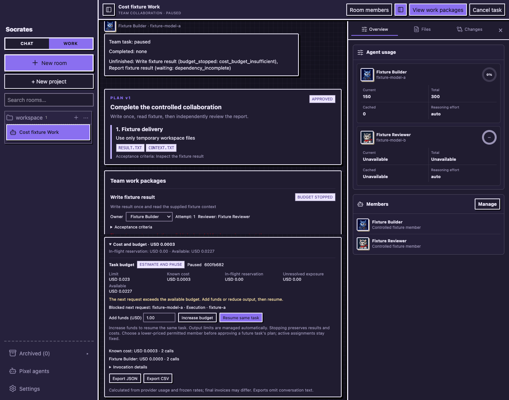
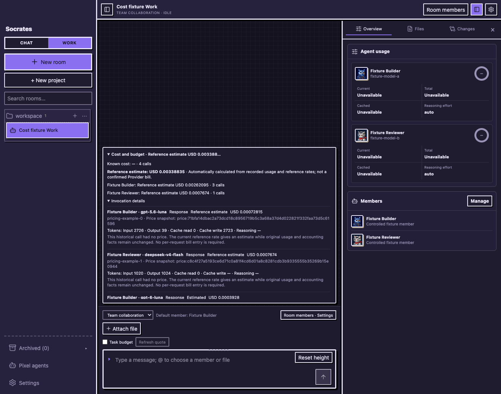
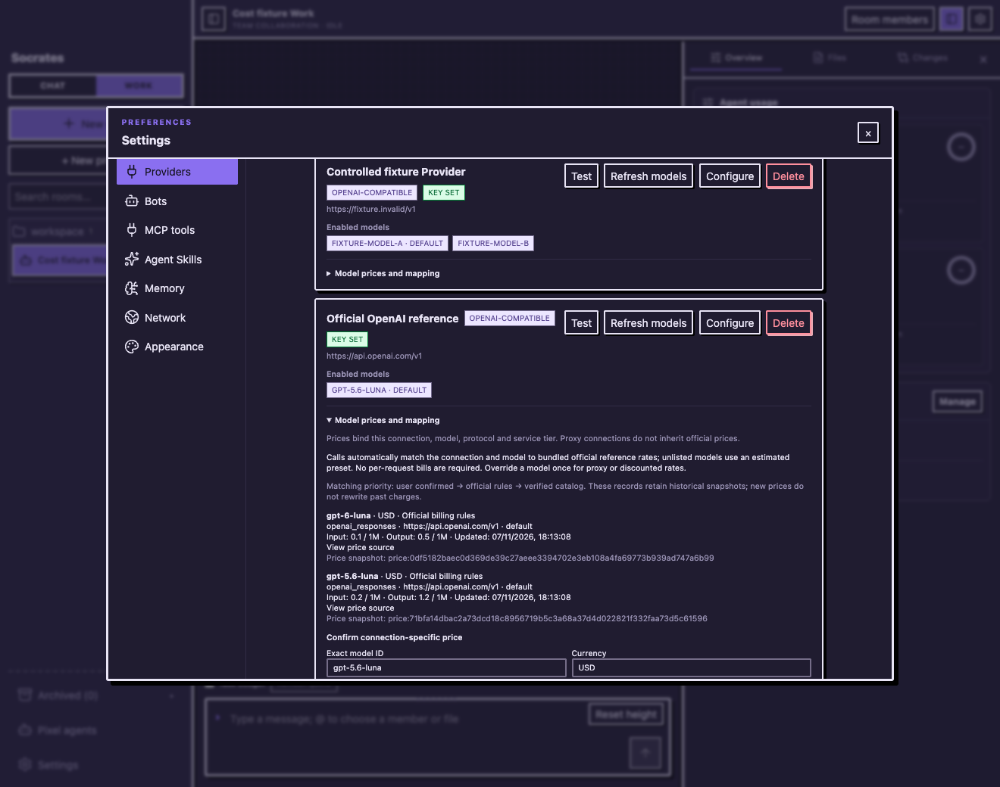
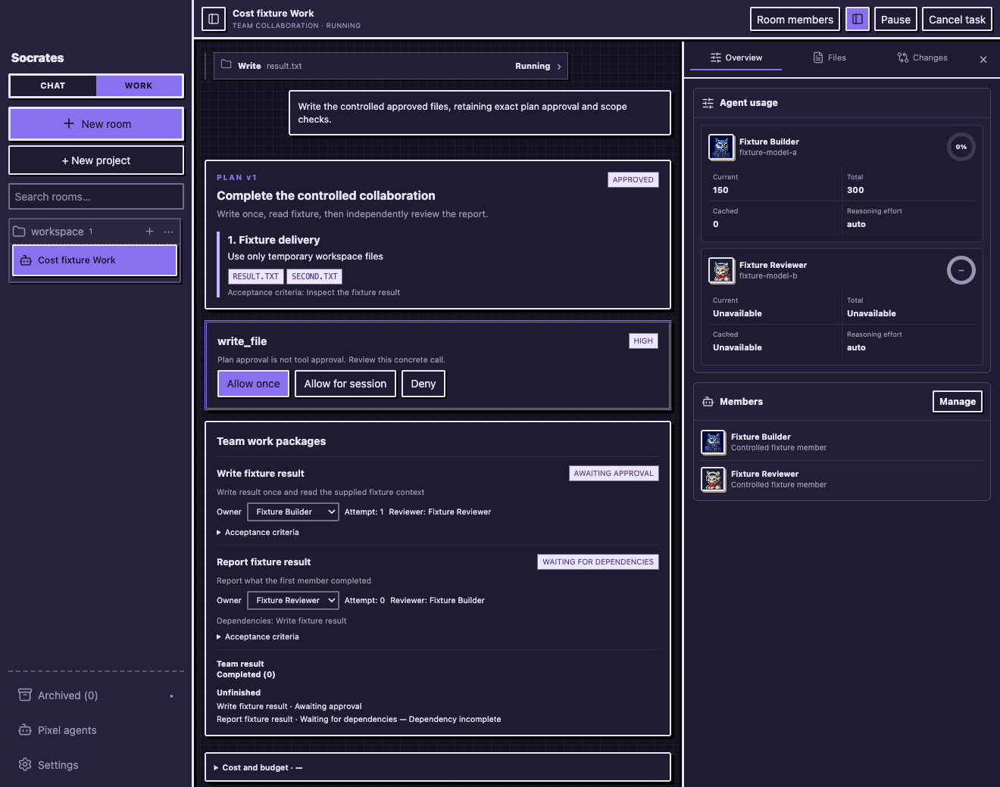

# Cost-aware Chat/Work acceptance (P00–P02)

This change makes actual model requests visible in a durable cost ledger and connects quotes and monetary budgets to the existing execution hosts. Users can see a quote, set a budget, observe a pause before the next request, add funds and resume the same task without repeating completed tool effects.

## Delivered behavior

- One physical invocation per model sampling attempt, bound to room/root/run/member/profile identity and an immutable connection/model/protocol/tier price snapshot.
- Decimal-string/bigint money, cache/reasoning-aware usage, known and estimated amounts, explicit uncertainty, separate invoice adjustments and private-text-free exports.
- Strict/soft/tracking policy admission across budget ancestors, atomic reservations, preserved unknown exposure, same-root topup/requote/resume and workspace lease release at a pause.
- Actual quote/composer/ledger/provider UI. Output allowances are application policy; planning can spend its existing one repair attempt on a larger allowance after a known truncation, subject to fresh monetary admission.
- Automatic official reference prices for supported exact connections; unlisted/proxy models use labelled presets. A single optional model override applies to future calls. Historical current-reference estimates retain original accounting facts.
- Compatibility with both known 023 schema baselines through append-only 024. Scoped session approvals use append-only 025; existing histories, approvals and accounting are retained.
- Regression fixes for empty Chat discussion defaults, stale/new-file write preconditions, and actual reuse of non-destructive writer session grants after permission and plan-scope checks.

## Final validation

| Check | Observed result |
| --- | --- |
| `bun test` | 998 passed, 0 failed; 180 files, 22,294 assertions |
| `bun run typecheck` | Passed |
| `bun run --cwd apps/desktop build` | Passed; existing mixed-import/large-bundle warnings remain |
| Opt-in actual promptfoo `evaluate()` | 1 success, 0 failures; one Socrates command, 15 tokens; outbound fetch forbidden |
| LangGraph compatibility | Actual persisted graph interrupt/restart/resume/cancellation tests; one service dispatch, no second production team owner |
| Startup | Actual child sidecar entry, stdout handshake and authenticated HTTP bootstrap from an early-023 temporary database |

The Chrome checks below were captured at their respective implementation milestones. The latest automatic-pricing run verifies the final pricing path. Captures use the real React UI and production business services with only the external model/fault stream controlled. Names, workspaces, credentials and amounts in the images are synthetic fixtures.

| Controlled Chrome workflow | Checks | Reproduction |
| --- | --- | --- |
| Quotes, Native tools, budget pause/topup/resume, exports, uncertain outcomes and room isolation | 22/22 | `scripts/cost-aware-browser.mjs` |
| Chat settings and automatic planning expansion across a budget pause | 10/10 | `scripts/collaboration-regression-browser.mjs` |
| Session allow, automatic second write and fresh plan expansion | 8/8 | `scripts/write-approval-browser.mjs` |
| Automatic reference amounts, no per-call bill forms, model override and unchanged original/frozen charges | 11/11 | `scripts/automatic-pricing-browser.mjs` |

All recorded browser workflows reported zero renderer exceptions and zero external browser requests. Sanitized check lists are in [assets/cost-aware](assets/cost-aware/README.md). Raw host logs and any local-data repair/copy metadata remain local; they are not included in the PR.

## Controlled UI captures









## Reproduction and limits

Run the three standard gates above from the repository root. The opt-in evaluation package stays outside shipping dependencies:

```sh
bun install --cwd scripts/reuse --ignore-scripts
bun run --cwd scripts/reuse promptfoo
```

Browser script headers document the isolated fixture switches; point `SOCRATES_PLAYWRIGHT_MODULE` at an installed Playwright module and run a loopback Vite instance. All fixtures create disposable SQLite/workspaces and fake credentials. No live Provider or actual-user workspace is a test target.

No paid inference, native Tauri WebView verification, release or deployment is claimed. Prices are versioned reference data, not live invoices; unverified presets cannot prove strict bounds. Live catalog refresh, administrative bill sync, exact holiday calendars and additional verified provider coverage remain follow-ups. LangGraph remains a tested compatibility path; Native/TeamRunner retain production ownership. P03–P08 are outside this PR.

See [cost-aware reuse](cost-aware-reuse.md), [automatic pricing](automatic-model-pricing.md), [accounting ADR](../docs/adr/0009-model-invocation-cost-and-budget-authority.md) and [implementation progress](../implementation-progress.md) for the detailed decisions and milestone evidence.
