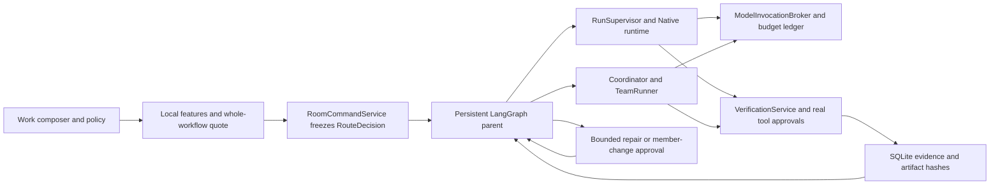

# Cost-aware Work verification and routing — P03–P04

Implemented against `main` `4a67a2e` on `codex/cost-aware-p03-p04`. The original Alpha.1 prompt describes an older baseline. This document describes the production path after the scrolling repair and P03–P04; historical P00/M00 acceptance documents retain their original scope.

## Ownership and compatibility

Chat still has no workspace or tools. Existing single/team rooms keep their explicit strategy and existing execution path. Opening a room does not change its policy. Choosing Economy, Balanced or Quality enables `adaptive`; Custom writes manual routing while retaining an explicit single/team workflow. `@all` and explicit discussion remain bounded discussion. An adaptive `@A` targets A; a Custom team `@worker` narrows executors while retaining its explicitly configured manager, reviewer and speakers.

The graph owns the routed parent lifecycle, not model sampling or tools. Existing Native/Coordinator/TeamRunner own each child operation. Only one active attempt is dispatched at a time. Workspace writes retain their existing serialized leases; no parallel-speedup claim is made. The older experimental `LangGraphAgentRuntime` is not registered as another tool-loop owner.

Migration 026 adds verification plans/runs/evidence/acceptance. Append-only migrations 027 and 028 add frozen decisions, workflows, attempts, approvals and idempotent requests. Existing room, member, message, run and cost rows are preserved. LangGraph checkpoints contain root IDs, while SQLite service records remain authoritative. Child IDs and stable request keys are saved before or recovered after dispatch. A lost launch reply is reconciled with existing durable children; absence of trustworthy execution evidence blocks automatic replay.

## Local decisions and their limits

`RoutePolicyService` reads bounded metadata in the already selected workspace and explicit file references. It checks path/secret boundaries, room snapshots, credentials availability, provider egress, model tools/modalities/protocol/context, price validity, risk and verification. Secret values never enter the decision. It does not ask a model to classify a task or scan unrelated directories.

Current dependency evidence covers `package.json` declarations and relative imports in selected files. Cargo, Python and Go manifests establish module boundaries but not a verified dependency graph; such uncertainty blocks automatic independent-team decomposition. Unknown capability/context/credentials fail closed. For this first implementation all eligible Work candidates must support tools and the Native runtime, even when a particular role only plans or reviews; this deliberately excludes otherwise possible text-only planners.

Candidates are direct execution, plan plus execution, execution plus independent review, and multiple package owners plus integration. Whole-workflow stages include configured discussion, planning and structured-plan repair, execution, checks, review, bounded repair/escalation allowance and integration. Prices and roles are frozen with the quoted decision. Unknown/unverified prices never win by being treated as zero. Strict admission retains the existing conservative provider/context requirements.

The policy version is deterministic. Economy compares conservative total-cost intervals after hard filters. Balanced applies explicit risk/module preferences then cost/call-count tie-breakers. Quality prefers feasible decomposition or independent review, within the same limits. Custom preserves fixed assignments and workflow. These are cold-start rules, not measured success probabilities, latency estimates or evidence of one model's superiority. A quote can expose a cheaper alternative and explain exclusions; insufficient budget produces no executable candidate. No savings percentage is displayed.

## Verification and bounded recovery

A task can finish execution without passing acceptance. `VerificationService` hashes approved checks, protected definitions and artifact snapshots, executes real local commands through existing permissions/leases/process supervision, and stores evidence/output references. File/schema assertions are local; JSON Schema uses Ajv. Zero tests, unsupported reports, stale artifacts, changed test contracts, denied permission, timeout or missing environment cannot mint a pass. Explicit acceptance is recorded as `completed_unverified`.

Package dependencies and reviewer release use current evidence. Final integration cannot turn an accepted/unverified package into an aggregate verified success. Resuming a satisfied verification gate reuses still-valid evidence and does not ask to rerun the same command unnecessarily. Historical attempts remain inspectable; their retired verification targets cannot be rerun or accepted as the current delivery.

The routing defaults are **1 repair, 1 escalation and 24 physical model calls**. Product bounds are 0–3 repairs/escalations and 1–100 calls. They are configurable safeguards, not optimal values. Every model call reserves its slot atomically alongside its cost-ledger row and rechecks current permissions and frozen identity before sending. Call and money budgets are distinct; neither a retry nor a new member resets them.

Repeated failure signatures with unchanged artifact hashes stop. Network, authentication, permission, environment and unknown-side-effect failures do not imply a model capability gap. Evidence handoff preserves the original user objective and passes diagnostics as explicitly untrusted historical context. New attempts have distinct identities, carry completed work/evidence, remain inside the frozen envelope and require renewed admission. Member changes use only explicitly permitted fallback candidates and require a durable user decision. Unknown external effects require reconciliation instead of automatic replay.

Budget resume uses the original quote, decision, member, model and price with the current ledger. It resumes the existing turn/attempt and durable tool facts; changing current room defaults or prices does not rewrite historical charges. Current revocations still apply. Cancel/shutdown wait for the child owner and final persisted facts. Restart restores a paused workflow and requires explicit resume. Pending routed work prevents workspace rebinding, history rewind, archiving or deletion even if its last child has already stopped.

## Actual reuse and reproducible evidence

- `@langchain/langgraph` 0.2.74 and checkpoint 0.0.18 (MIT): actual production `StateGraph`, interrupts and `Command` resume in `services/adaptive-workflow.ts`; the existing `BunSqliteCheckpointSaver` supplies persistence. Tests reopen the same temporary database in another Bun process. This extends the P00 compatibility proof into registered production execution.
- Ajv 8.20.0 (MIT): actual compiled JSON Schema checks in P03; asynchronous schemas are rejected. Command execution/output capture, workspace policy/leases and approvals reuse Socrates modules.
- Existing Vercel AI SDK, immutable price/cost/budget services, RunProfile, Native tools, Coordinator, TeamRunner, Base UI drawers, RoomTimeline and room-scoped Zustand projections remain in use. No Multica source or new competing Agent runtime was added.

Backend tests include `adaptive-workflow.test.ts`, `adaptive-hosts.test.ts`, `adaptive-history.test.ts`, `route-policy.test.ts`, `routing-admission.test.ts`, `cost-task-service.test.ts` and P03 verification integration tests. The actual UI fixture executes those production services with only the provider stream replaced. `scripts/routing-browser-fixture.ts` and `scripts/routing-browser.mjs` compare the same tasks across all four presets, exact candidate selection, actual role identity, file checks, approvals, rejection, cancellation, permission filtering and reload. Screenshots and machine-readable checks are local under `output/playwright/routing/`.

The validation boundary is explicit: synthetic offline responses prove routing, accounting, tools, approvals and persistence wiring. They do not prove live-model task quality, cost savings, provider entitlements or native Tauri window behavior. Follow-up work includes measured Arena calibration, additional dependency/report adapters, provider price refresh, project memory and later P05–P08 capabilities. None is silently represented as complete here. Final gate counts and evidence locations are recorded in `implementation-progress.md`.
