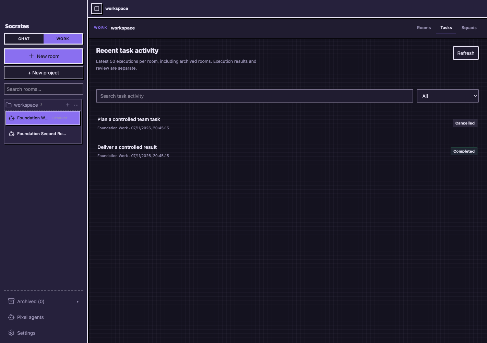
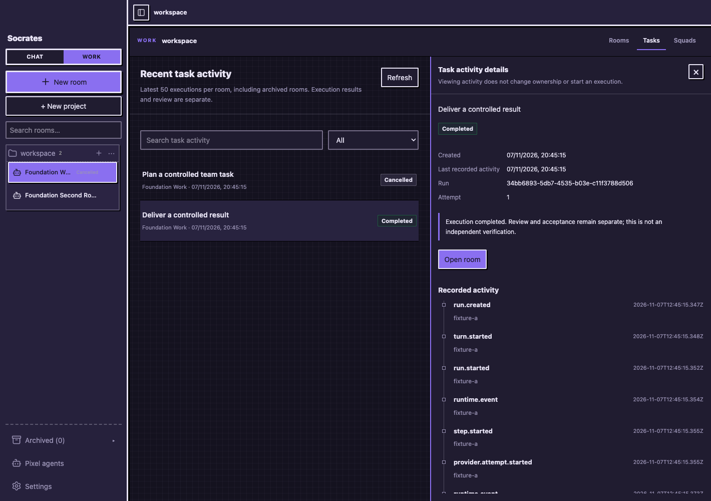
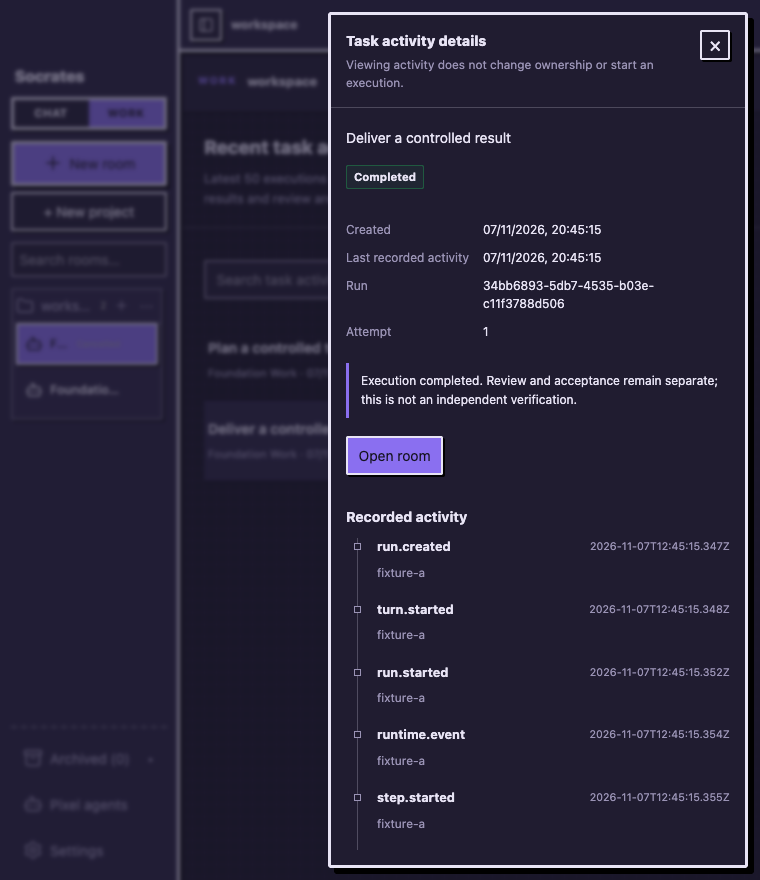
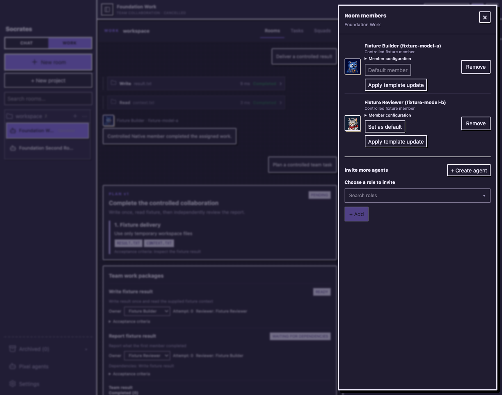
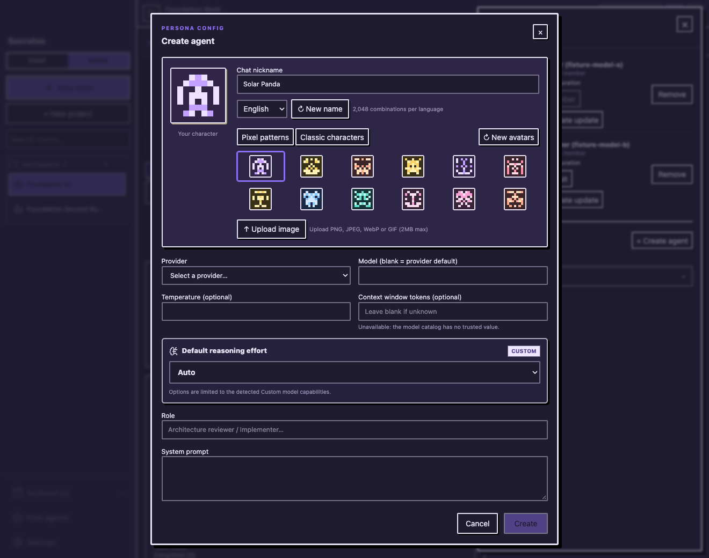

# Work interaction foundation acceptance — M00–M01

This delivery builds on `main@b71a826` and its cost-accounting implementation. The original checkout and supplied prompt pack remain unchanged; implementation is on `codex/multica-ux-m00-m01`. The implementation phase did not push or publish. Subsequent user authorization for code/PR submission is recorded in [implementation progress](../implementation-progress.md).

## Delivered user flows

- Work has **Rooms / Tasks / Squads** contexts. Rooms retain the existing composer, explicit strategy, approvals, files/diff and cost/budget controls. Chat retains its separate lightweight room interface.
- Tasks shows the latest **50 executions per room**, including archived rooms and commandless legacy team tasks. Selecting a row opens actual run/task identifiers, attempt, timestamps, state and bounded recorded events. Viewing, refreshing and filtering do not start a model.
- Detail panels resize by pointer/keyboard; at narrow widths they become focus-managed drawers. Workspace inspection reuses the existing dock in the same drawer. New narrow room views keep the dock closed until requested.
- A task's execution result remains distinct from review/acceptance. Squads is an explicit unavailable state pending M02; no fake team records, task owner controls or independent verification state are introduced.
- The production member editor uses the adopted Base UI search/picker and dialogs. Chinese search, IME, list keyboard selection, explicit add, confirmed remove, focus return, nested role creation and local success notifications are connected to the original room services.
- Room drafts, task selection and reading position remain isolated. Sidebar navigation and task metadata subscribe independently of token streams.

The shared `ObjectPage`, `DetailPanel`, `ActorPicker`, `StatusBadge`, `ActivityTimeline`, `EmptyState`, `ConfirmationDialog`, loading/error, tooltip and notification components all have business call sites. They are not standalone demos.

## Authority and compatibility

The new GET activity endpoints are projections over existing commands, team tasks and Native/task/discussion events. They carry no tool arguments, result payloads, environment values or credentials. They reject Chat/wrong-room/revoked records and expose real read failures separately from missing history. Earlier Native attempts remain inspectable and team commands are deduplicated against their legacy task identities.

There is **no new database migration** in M01. All existing SQLite migrations continue through the regression suite. A future minimal WorkItem entity is justified in [the domain design](work-interaction-domain.md); M01 does not copy execution status into a second mutable task model. Native Runtime, permission/approval, workspace lease, quote/pricing/budget and History authority remain unchanged.

## Verification

| Check | Final observed result |
| --- | --- |
| `bun test` | **1,016 passed, 0 failed**, 184 files, 22,393 assertions |
| `bun run typecheck` | Passed |
| `bun run --cwd apps/desktop build` | Passed; existing mixed-import/large-chunk warnings remain |
| `bun run lint` | Passed, 433 files |
| Real Chrome project/navigation flow | **29/29 checks** |
| Real Chrome shared components/roster flow | **36/36 checks** |
| Browser renderer exceptions / external requests | **0 / 0**, both workflows |
| New model calls caused by either UI validation workflow | **0** (gateway and Native counters unchanged after fixture setup) |

The complete suite includes actual sidecar startup and migration preservation, production Native/approval/budget integration, room/store isolation and the new read-only activity projection tests. New service tests demonstrated zero SQLite `total_changes()` and no new model calls during reads. Initial red tests reproduced missing activity APIs, incorrect read-failure classification and missing state normalization before fixes.

Chrome uses the real React application and production Hono/store/services, with only the Tauri handshake/menu boundary and external model responses controlled. The temporary fixture creates real executions before browser inspection; it never targets the user's database, Keychain or workspace. Initial integration tests found and fixed removed-trigger focus return, nested editor stacking, same-room navigation, unchanged-state event refresh and narrow-dock first-toggle behavior. The full-browser results below are after those fixes.

Performance measurement uses CDP precise JavaScript coverage and the **exact already loaded Vite Store module**. A real language-change control invokes RoomSidebar and WorkProjectHub four times each; 20 successive stream updates invoke neither. V8 omits unexecuted functions, so empty call arrays mean zero only after that positive control. This avoids a misleading result from importing a second hot-reload Store instance. See [render evidence](assets/work-foundation/render-coverage.json).

Both themes were inspected in Chrome. Minimum sampled text contrast was **5.43:1**; English, Simplified Chinese and Traditional Chinese labels passed. See [navigation checks](assets/work-foundation/checks-navigation.json) and [component checks](assets/work-foundation/checks-components.json).

## Actual reuse and size

[Source/license decisions](reuse-decisions.md) and the [source manifest](assets/work-foundation/source-audit.json) cover the pinned/current Multica revisions and the independently published candidates. Multica is a behavior reference only. Adopted package: MIT `@base-ui/react@1.9.0`; [copyright notice](third-party-ui-notices.md) retained. cmdk and react-resizable-panels are deferred because their capabilities overlap Base UI and Socrates' existing resize controls.

A separately exported clean baseline with frozen dependencies was built on the same host. Summing individually gzipped emitted JS/CSS (level 9, mtime 0): baseline **575,438 bytes**, final **649,945 bytes**, delta **74,507 bytes / 72.76 KiB**. This is the complete M00/M01 change, **not** Base UI alone, first-load transfer size or a Tauri installer measurement. [Full comparison](assets/work-foundation/bundle-comparison.json).

## Controlled captures











## Reproduction

After installing the locked dependencies, run the four checks in the validation table. For the controlled browser flows, start two separate loopback processes:

```sh
bun run scripts/work-foundation-fixture.ts
bun run --cwd apps/desktop dev --host 127.0.0.1 --port 45348 --strictPort
```

Point `SOCRATES_PLAYWRIGHT_MODULE` to an installed Playwright `index.mjs`, then run each script sequentially (the component script temporarily changes and restores fixture language/theme):

```sh
node scripts/work-foundation-browser.mjs
node scripts/work-foundation-components-browser.mjs
```

Both scripts check the synthetic fixture identity before proceeding. Stop the fixture with SIGTERM/SIGINT to delete its disposable database/workspace. Raw debug dumps and machine-specific logs are local outputs, not release assets.

## Remaining stage dependencies

- M02: persist reusable Squad definitions, Leader/roster/instructions, versioning and archive impact; bind to existing Work rooms without changing old membership snapshots.
- M03: persist lasting WorkItems and explicit assign-only / assign-and-start semantics, using the designed stable links to the existing execution hosts. A recent execution row is not a backlog item.
- M04–M05: evidence-based availability/workload, richer Run views, structured Squad mentions, handoff and local Inbox.
- M06–M07: connect those new entities to existing quote/budget/verification seams, then run whole-flow migration/assignment/recovery QA.

No paid/live provider call or native Tauri WebView verification is claimed. Event details are bounded to 500 records; discussion events without stored occurrence time remain unknown. Browser compatibility is verified in Chrome; production native WebView behavior remains an explicit validation boundary.
