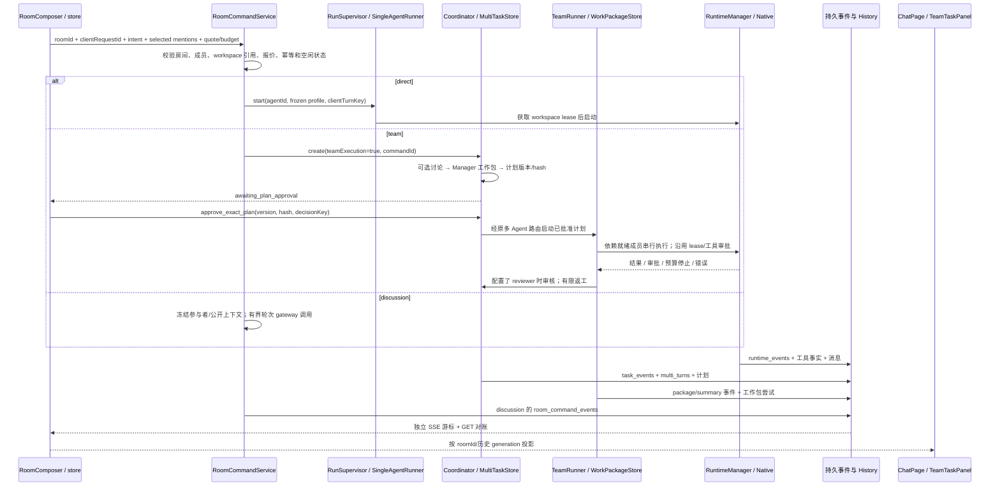
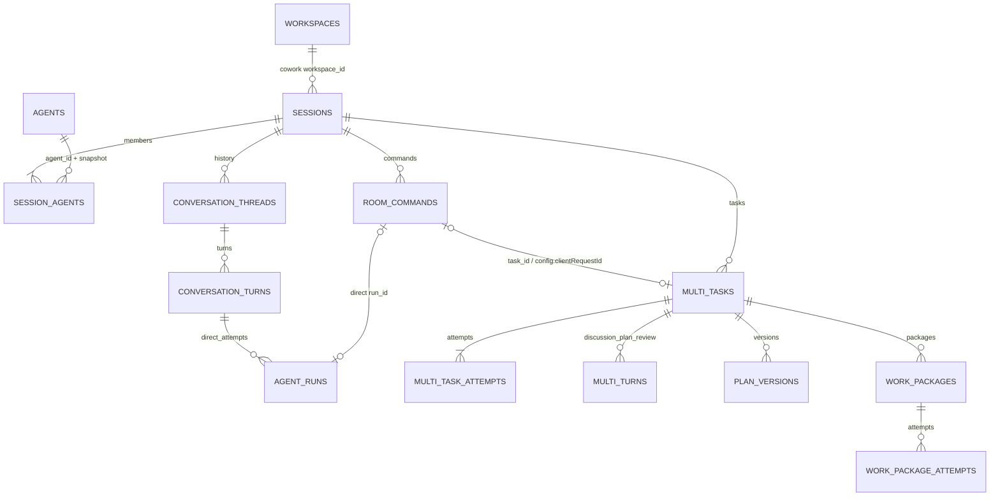
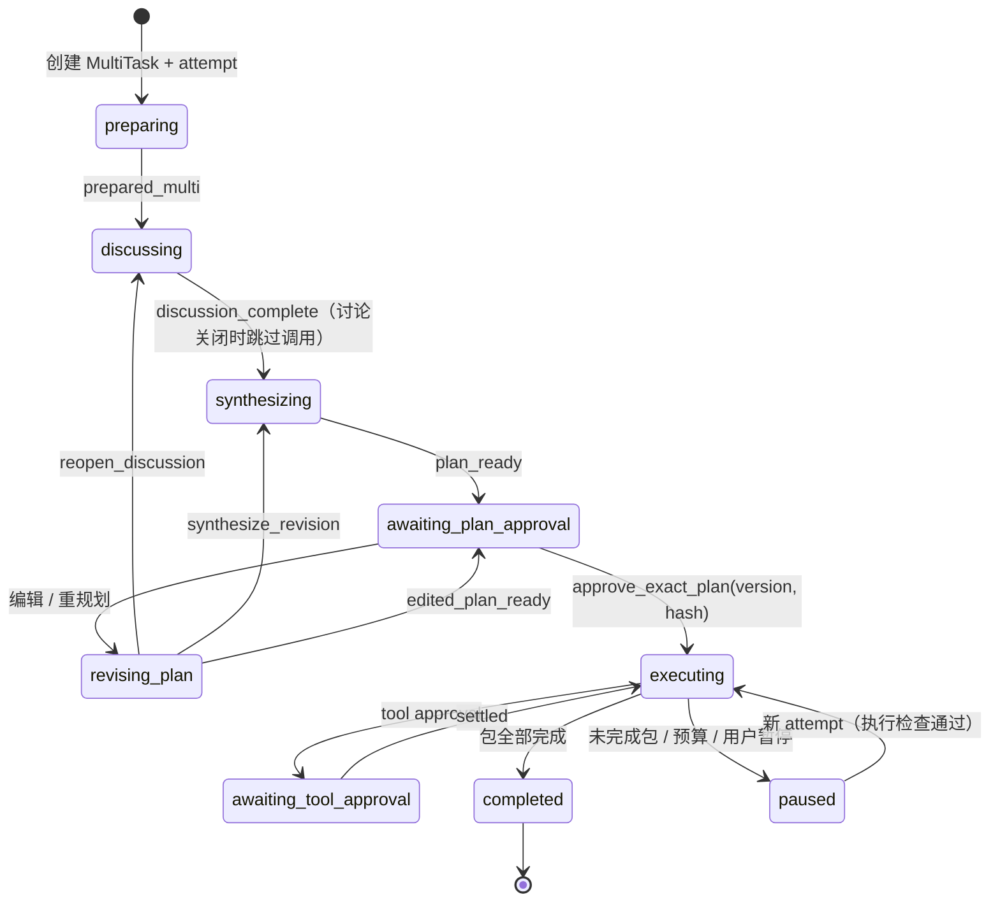
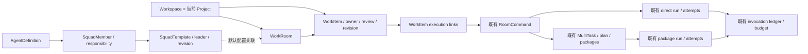
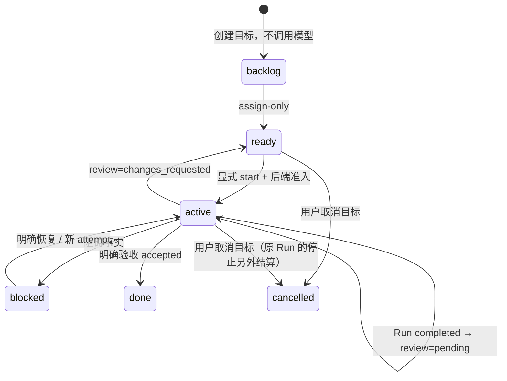

> 2026-11-11 M02–M03 已落实下述 Squad/WorkItem 设计：034–036 迁移、独立 bindingVersion、持续 owner 与运行快照、显式预览/启动及人工审核。现行接口和验收以 [M02–M03 实现记录](multica-m02-m03-acceptance.md) 为准；下文含 M00 原始设计，不代表后续 M04–M07 已实现。

# Work 交互领域、状态权威与迁移边界

审计日期：2026-11-07（Asia/Singapore）。源码基线：`b71a8265b9e296947c1f5ef7879f08feca899852`，分支 `codex/multica-ux-m00-m01`。本文件服务于 **RUN_SCOPE=M00–M01**：核对已有运行链，增加可复用交互和只读执行记录投影；Squad 持久化、长期负责人、分配后启动、Agent 生命周期与 Inbox 属于 M02–M07。

输入契约：原始 `prompt/Socrates_Multica_UX_Squad_Prompt_Pack` 的 `MASTER_PROMPT.md`、`specs/{FOUNDATION,DOMAIN_CONTRACT,UX_BLUEPRINT}.md`、`tasks/{M00_SOURCE_REUSE_AUDIT,M01_INTERACTION_FOUNDATION}.md`。实际代码优先于提示包中 `Alpha.1@8f5fa2` 的旧快照，也优先于路线图里的历史待办。架构入口为 [当前架构](architecture.md)、[演进路线](native-runtime-and-langgraph-roadmap.md)、[Chat/Work 验收](chat-work-collaboration-acceptance.md)。

## 1. 结论与词义

**M01 用只读 WorkItemProjection 足够；完整长期工作事项需要后续最小实体。** 本阶段的 Tasks 入口聚合已有命令、团队任务和执行记录，不能承诺尚未存在的 backlog、持久 Owner、只分配不执行或独立验证。名称可继续使用 Tasks，但行文必须解释“已有工作执行记录”，不能把一个 completed Run 描述为“目标已验收”。

| 词 | 含义和当前落点 | 不应承担的职责 |
| --- | --- | --- |
| Work Project | 当前是 `workspaces` 对应的本地项目组织视图；同一 workspace 下有多个 Work Room。迁移 008 添加归档与索引，没有独立 `projects` 表 | 不能把 UI 项目选择当作可任意更改的执行目录 |
| AgentDefinition | `agents` 中的长期角色/模型配置；成员和本次执行另有快照 | 不代表一个常驻在线进程 |
| SquadTemplate（未来） | 可复用的 Leader、成员、职责、Leader instructions、默认策略及版本 | 不等于 Room；不拥有另一套执行器、费用账本或工具权限 |
| Room | `sessions`：讨论上下文、成员快照、默认回应者、workspace 和协作设置；`kind=chat|cowork` | 不是单个工作目标，也不是一次 Run |
| RoomCommand | 用户一次结构化请求及其稳定幂等身份；`direct|discussion|team` 分派入口 | 不是独立长期 Owner 或审核状态 |
| WorkItemProjection（M01） | 对现有 command/task/run 的只读统一视图，保留源类型、源 ID 和来源状态 | 不另存第二份运行状态，不伪造持久 WorkItem ID |
| WorkItem（未来） | 跨多次执行保留的目标、负责人、工作流与验收决定 | 不复制消息、工具输出、成本或任务状态机 |
| MultiTask / WorkPackage | 已有 Manager 规划、精确计划批准、依赖、执行、成员审核与有限返工 | 不应被强行改名为长期 issue/Owner |
| Run / Attempt | 一次实际执行/尝试；direct 与 package 的存储形状不同 | completed 只说明执行终态；不自动成为 WorkItem 的已验收状态 |

本文带行号的源码链接固定到审计基线；M01 新接口以 [WorkActivity DTO](../packages/core/src/work-activity.ts)、[生产 Service](../apps/sidecar/src/services/room-command-service.ts)、[路由](../apps/sidecar/src/routes/room-commands.ts) 和 [隔离集成测试](../apps/sidecar/src/services/work-activity.test.ts) 为准。

当前 `NavigationTarget` 仅有 chat room、cowork room、cowork workspace；Settings 是 overlay。[导航契约](https://github.com/Haosen-Zhang/Socrates/blob/b71a8265b9e296947c1f5ef7879f08feca899852/packages/core/src/navigation.ts#L16) 和 [项目组织迁移](https://github.com/Haosen-Zhang/Socrates/blob/b71a8265b9e296947c1f5ef7879f08feca899852/apps/sidecar/src/store/migrations/008_project_conversation_organization.ts#L4) 是新 Tasks/Squads 视图的边界。M01 的项目子视图保持在 Work 上下文内，不能让 Chat 获得 workspace 或任务约束。

## 2. 实际调用链与读回链



逐段证据与可复用接缝：

| 链段 | 真实行为 | 证据 |
| --- | --- | --- |
| Composer → store | 只显式菜单选择生成结构化 mention；草稿/mention 按 room ID；提交使用当前策略和绑定报价；IME 判断独立 | [RoomComposer 17、98、130](https://github.com/Haosen-Zhang/Socrates/blob/b71a8265b9e296947c1f5ef7879f08feca899852/apps/desktop/src/RoomComposer.tsx#L17)、[提交与错误恢复](https://github.com/Haosen-Zhang/Socrates/blob/b71a8265b9e296947c1f5ef7879f08feca899852/apps/desktop/src/RoomComposer.tsx#L98) |
| store → room commands | HTTP 202 后根据 runId/taskId 订阅；不确定提交保留请求 ID/原报价；当前房间不等于事件归属房间 | [sendRoomCommand](https://github.com/Haosen-Zhang/Socrates/blob/b71a8265b9e296947c1f5ef7879f08feca899852/apps/desktop/src/store.ts#L671) |
| 命令仲裁 | Chat 禁止 execute/工作区文件 mention；成员合法性、显式 intent/strategy 决定 direct/discussion/team；文本 `@name` 不参与仲裁 | [resolveRoomCommand](https://github.com/Haosen-Zhang/Socrates/blob/b71a8265b9e296947c1f5ef7879f08feca899852/packages/core/src/room-command.ts#L25) |
| RoomCommandService | `(room_id,client_request_id)` 唯一且比对 fingerprint；新请求校验报价/成员/引用后立即 dispatch，没有 assign-only 分支 | [submit/dispatch](https://github.com/Haosen-Zhang/Socrates/blob/b71a8265b9e296947c1f5ef7879f08feca899852/apps/sidecar/src/services/room-command-service.ts#L55)、[迁移 020](https://github.com/Haosen-Zhang/Socrates/blob/b71a8265b9e296947c1f5ef7879f08feca899852/apps/sidecar/src/store/migrations/020_room_commands.ts#L8) |
| direct | RunSupervisor 持有后台运行/取消；durable lookup 优先于完成缓存；SingleAgentRunner 建 turn、run 和尝试，处理 lease、消息与恢复 | [RunSupervisor](https://github.com/Haosen-Zhang/Socrates/blob/b71a8265b9e296947c1f5ef7879f08feca899852/apps/sidecar/src/runtime/run-supervisor.ts#L56)、[beginTurn](https://github.com/Haosen-Zhang/Socrates/blob/b71a8265b9e296947c1f5ef7879f08feca899852/apps/sidecar/src/runtime/single-agent-runner.ts#L620)、[lease/native open](https://github.com/Haosen-Zhang/Socrates/blob/b71a8265b9e296947c1f5ef7879f08feca899852/apps/sidecar/src/runtime/single-agent-runner.ts#L830) |
| team 创建/规划 | index 的 createTeam 复用 Coordinator；MultiTaskStore 冻结 memberProfiles 和公开历史 cursor；存量任务仍走同一 API | [装配](https://github.com/Haosen-Zhang/Socrates/blob/b71a8265b9e296947c1f5ef7879f08feca899852/apps/sidecar/src/index.ts#L228)、[任务创建](https://github.com/Haosen-Zhang/Socrates/blob/b71a8265b9e296947c1f5ef7879f08feca899852/apps/sidecar/src/multi-agent/task-store.ts#L71)、[讨论/综合](https://github.com/Haosen-Zhang/Socrates/blob/b71a8265b9e296947c1f5ef7879f08feca899852/apps/sidecar/src/multi-agent/coordinator.ts#L93) |
| 批准/执行 | 批准 exact version/hash；TeamRunner 再校验 approved hash/planVersion；单 workspace 串行调度；package 尝试单独保存 | [批准](https://github.com/Haosen-Zhang/Socrates/blob/b71a8265b9e296947c1f5ef7879f08feca899852/apps/sidecar/src/multi-agent/task-store.ts#L363)、[TeamRunner](https://github.com/Haosen-Zhang/Socrates/blob/b71a8265b9e296947c1f5ef7879f08feca899852/apps/sidecar/src/multi-agent/team-runner.ts#L36)、[attempts](https://github.com/Haosen-Zhang/Socrates/blob/b71a8265b9e296947c1f5ef7879f08feca899852/apps/sidecar/src/multi-agent/work-package-store.ts#L70) |
| Native/副作用 | 生产 factory 再查 provider、key、能力、workspace；工具沿用 registry/executor/Approval；执行前先拿 lease | [Native factory](https://github.com/Haosen-Zhang/Socrates/blob/b71a8265b9e296947c1f5ef7879f08feca899852/apps/sidecar/src/index.ts#L110)、[工具调用](https://github.com/Haosen-Zhang/Socrates/blob/b71a8265b9e296947c1f5ef7879f08feca899852/apps/sidecar/src/runtime/native-agent-runtime.ts#L546)、[package lease](https://github.com/Haosen-Zhang/Socrates/blob/b71a8265b9e296947c1f5ef7879f08feca899852/apps/sidecar/src/runtime/execution-runner.ts#L118) |
| 持久事件 → UI | 持久 SSE 重放；room/time-generation 校验防止 A 污染 B；task 面板仅操作现有后端 | [命令 SSE](https://github.com/Haosen-Zhang/Socrates/blob/b71a8265b9e296947c1f5ef7879f08feca899852/apps/sidecar/src/routes/room-commands.ts#L24)、[observer](https://github.com/Haosen-Zhang/Socrates/blob/b71a8265b9e296947c1f5ef7879f08feca899852/apps/desktop/src/store.ts#L436)、[TeamTaskPanel](https://github.com/Haosen-Zhang/Socrates/blob/b71a8265b9e296947c1f5ef7879f08feca899852/apps/desktop/src/TeamTaskPanel.tsx#L11) |

**Leader 的未来行为要求仍需新增业务契约。** 当前 team 仲裁会在非讨论路径将 coordinator 纳入检查/创建 Manager 任务，但 Coordinator 可以按房间配置先讨论，再综合工作包；不能把这一点宣传为已实现 Squad 的“只唤醒 Leader 一次 → 成员回报后幂等唤醒 Leader”。M02/M03 先禁用自动全员讨论并复用 Manager/TeamRunner；M05 再添加有界的委派/回报控制。

## 3. 实体关系与唯一状态权威

### 3.1 当前持久关系



图中 command→task/run 是已有逻辑引用，不声明所有列已有外键。package Run 的稳定 ID 为 `package:<packageId>:<attemptNo>`，由 `ExecutionRunner` 写 runtime_events；它**不保证有 agent_runs 行**。后续 Run 列表必须以带 `sourceKind` 的联合投影覆盖 direct 和 package，不能只查 agent_runs。没有 command 的 legacy `/multi` 任务仍须可读。[工作包迁移](https://github.com/Haosen-Zhang/Socrates/blob/b71a8265b9e296947c1f5ef7879f08feca899852/apps/sidecar/src/store/migrations/021_team_work_packages.ts#L7)、[Run 生成/持久终态重用](https://github.com/Haosen-Zhang/Socrates/blob/b71a8265b9e296947c1f5ef7879f08feca899852/apps/sidecar/src/runtime/execution-runner.ts#L73)。

| 事实 | 唯一写入/控制权威 | 只读投影和限制 |
| --- | --- | --- |
| Room 类型、workspace、成员/默认人、collaboration | SessionStore + core 房间/协作校验；成员 snapshot 独立于 AgentDefinition | session.status 是运行层写入的房间忙闲投影，不能当长期 WorkItem 状态 |
| 用户命令、重发/回退有效性 | RoomCommandService / room_commands；revoked 命令不可重放 | get() 对 direct 最新 attempt、team state 取实际子状态；不能只读 room_commands.status |
| 团队编排、计划/attempt | MultiTaskStore + reduceTaskState；Coordinator/原路由负责动作 | multi_tasks.state 是本次团队工作流；WorkItem 状态不能反写这里 |
| 工作包分配/依赖/重试/审核 | WorkPackageStore；TeamRunner 安排运行；精确批准计划是门禁 | 负责人下拉当前只在 awaiting_plan_approval 可用；不是长期 Owner |
| direct Run | SingleAgentRunner / conversation memory 写入 agent_runs；RunSupervisor 管活任务；ExecutionEventStore 记事实 | getRun() 和 schema v1 事件重建结果；取消请求不等于取消已完成 |
| package Run | ExecutionRunner + WorkPackageStore.attempts + runtime_events | 通过 task/package/attempt 关联，不能虚构 direct agent_runs FK |
| 执行活动和重放 | ExecutionEventStore；类型/coordinates/重复 identity 校验；每 run 序号 | UI `ExecutionProjection` 丢弃重复并识别缺口；不是新的执行状态机 |
| 团队活动 | EventStore / task_events；每 session 序号，eventId 去重 | 可按 task 过滤；序号可能不连续，不能按 run 规则判 gap |
| discussion 活动 | RoomCommandService / room_command_events；每 command 序号 | direct 的活动要读 runtime_events，不能把空 room_command_events 误读为无活动 |
| 消息/工具历史、回退 | HistoryStore append journal + SQLite projection；conversation memory 引用 | 新 read model 保留 epoch/revoke/generation 语义；回退不删除/退款费用 |
| 工具审批、权限、未知副作用 | ApprovalManager、ToolExecutor/ToolExecutionJournal、workspace lease | Picker 可解释不具备准入权；修改职责文本不会改变权限 |
| 金钱/预算/报价 | ModelInvocationBroker、CostLedger/BudgetLedger、PricingStore、TaskQuoteService | UI 不乘虚构单价，不储存可变权威总额，不用新的 Squad 预算系统替代 |
| 工作项/团队状态（未来） | 专属最小服务及版本化表；与原执行状态分别控制 | M01 不存在这些写权威，因此只展示源事实和明确空态 |

关键源：[SessionStore 创建](https://github.com/Haosen-Zhang/Socrates/blob/b71a8265b9e296947c1f5ef7879f08feca899852/apps/sidecar/src/store/session-store.ts#L92)、[命令有效状态](https://github.com/Haosen-Zhang/Socrates/blob/b71a8265b9e296947c1f5ef7879f08feca899852/apps/sidecar/src/services/room-command-service.ts#L132)、[EventStore](https://github.com/Haosen-Zhang/Socrates/blob/b71a8265b9e296947c1f5ef7879f08feca899852/apps/sidecar/src/store/event-store.ts#L26)、[ExecutionEventStore](https://github.com/Haosen-Zhang/Socrates/blob/b71a8265b9e296947c1f5ef7879f08feca899852/apps/sidecar/src/store/execution-event-store.ts#L98)、[HistoryStore](https://github.com/Haosen-Zhang/Socrates/blob/b71a8265b9e296947c1f5ef7879f08feca899852/apps/sidecar/src/store/history-store.ts#L44)、[审批身份](https://github.com/Haosen-Zhang/Socrates/blob/b71a8265b9e296947c1f5ef7879f08feca899852/apps/sidecar/src/approvals/manager.ts#L54)。

### 3.2 当前状态转换



图省略各活跃阶段的失败/取消及 preparing/discussing/synthesizing 的暂停恢复；完整合法性以 [task-state reducer](https://github.com/Haosen-Zhang/Socrates/blob/b71a8265b9e296947c1f5ef7879f08feca899852/packages/core/src/task-state.ts#L38) 为准，不能由 UI 添加边。重启把活跃 MultiTask 标为 paused，并保留 unknown turn；未知副作用重试要显式核查。[恢复门禁](https://github.com/Haosen-Zhang/Socrates/blob/b71a8265b9e296947c1f5ef7879f08feca899852/apps/sidecar/src/multi-agent/task-store.ts#L187)、[重启恢复](https://github.com/Haosen-Zhang/Socrates/blob/b71a8265b9e296947c1f5ef7879f08feca899852/apps/sidecar/src/multi-agent/task-store.ts#L269)。

工作包实际状态是 `waiting → ready → running ↔ awaiting_approval → awaiting_review（配置 reviewer）→ completed`；失败、预算停止或取消单独保留。`request_changes` 至多自动返工一次；invalid review 失败后只重试只读审核，已完成副作用保持。[WorkPackageState](https://github.com/Haosen-Zhang/Socrates/blob/b71a8265b9e296947c1f5ef7879f08feca899852/packages/core/src/work-package.ts#L14)、[finish/review/retry](https://github.com/Haosen-Zhang/Socrates/blob/b71a8265b9e296947c1f5ef7879f08feca899852/apps/sidecar/src/multi-agent/work-package-store.ts#L84)。

Native 执行读模型使用 `ExecutionRunStatus=unknown|created|running|cancelling|completed|failed|cancelled|interrupted`。`waiting_workspace`、`waiting_approval`、`budget_stopped` 是需要证据的呈现原因，可分别来自 queue 事件、pending approval、interrupted 原因/预算账本；不能凭空增加数据库状态。`core/run-state.ts` 的通用状态机由 LangGraph adapter 使用，不等于所有生产 Native Run 均按该 reducer 落库。[ExecutionProjection](https://github.com/Haosen-Zhang/Socrates/blob/b71a8265b9e296947c1f5ef7879f08feca899852/packages/core/src/execution-events.ts#L122)。

Agent 展示分开回答三个问题：身份是否配置/停用（当前身份事实）；供应商/能力是否具备且何时检测（ready/degraded/unavailable/unknown，当前没有持久在线心跳）；具体 Run 是否 queued/running/awaiting_approval。失败属于 Recent Runs；不把角色永久标为 failed，不把配置存在标为 online。

## 4. WorkItemProjection 的边界与后续最小实体

### 4.1 M01：统一已有执行记录，不迁移执行内核

M01 选用现有 RoomCommandService 的 additive read 接缝：`GET /room-commands/rooms/:roomId/activity` 聚合命令与缺失 command 链接的 legacy multi task；`GET /room-commands/rooms/:roomId/activity/:activityId` 返回详情。项目 Tasks 在可见时约每 3 秒刷新当前 workspace 的 Work sessions；离开视图停止刷新。新增 API 只读、不创建 Run、不改负责人/审批、不建表。具体返回字段以该阶段代码为准。

投影至少保留以下语义：

```ts
// @socrates/core 的真实只读 DTO；不是新增的持久实体。
interface WorkActivityRecord {
  id: string;                  // command:<id> / multi-task:<id>
  source: "command" | "legacy_task";
  roomId: string;
  commandId?: string;
  taskId?: string;
  runId?: string;               // direct 最新 attempt；详情保留早先尝试
  kind: "direct" | "discussion" | "team";
  prompt: string;
  status: string;               // 来源的真实状态，保留 source
  error?: string;
  createdAt: string;
  updatedAt: string;
  attemptNo?: number;
}
interface WorkActivityEvent {
  id: string;
  type: string;
  occurredAt: string | null;    // 旧 discussion 事件未记录时间
  agentId?: string;
  runId?: string;
}
interface WorkActivityDetail {
  activity: WorkActivityRecord;
  events: WorkActivityEvent[];
  truncated: boolean;
}
```

列表去重先按 command.taskId 或 task.config.clientRequestId 关联；`MultiTaskConfig.clientRequestId` 在本链路保存的是 **command ID**，与 composer 的 clientRequestId 区分。legacy task 单独用 namespaced key。列出 recent 范围/分页能力；原 commands.list 仅最近 50 条，不能暗示拥有完整项目历史。详情动作回到原房间/TeamTaskPanel；M01 不暴露没有写 API 的 Owner 控件。

内部归属仍保留来源和独立游标；对 UI 只返回事件 ID、类型、真实时间/未知和 Agent/Run ID，不返回原 payload、工具参数或输出。三个游标空间互不互换：`task_events(sessionId, seq)`、`runtime_events(runId, seq)`、`room_command_events(commandId, seq)`。汇总时间线可以按时间排序展示；重连、去重和分页仍按各自来源游标。运行 ID 切换到后续 attempt 时，新旧条目都保留。

### 4.2 为什么长期功能不能只靠投影

| 产品要求 | 当前表能否独立表达 | 实际证据/处理 |
| --- | --- | --- |
| 浏览已有工作执行、源状态和消息/计划 | 可以 | command/task/run+History 联合读取；M01 投影覆盖 |
| 创建 backlog；只分配稍后启动 | 不可以 | RoomCommandInput 没有 note/assign；dispatch 100–124 总是启动；MultiTask 创建即 preparing 并创建 attempt |
| 一个目标跨多个新请求/重试，独立长期 Owner | 不可以 | Room 是容器；primaryAgent 是默认 responder；package.executor 属于具体计划；command 只指一次分派 |
| 本机用户/Agent/Squad 为 owner；临时 @ 不改 owner | 不可以 | 现有 schema 没有 typed owner；不能从 mention 或默认执行者反推 |
| 执行完成后等待人类验收、再设 done | 不可以完整表达 | 团队 package reviewer 已存在，但长期目标验收和独立产物验证状态没有实体 |

因此在 **M03 实现上述写行为前**，新增最小 `work_items`，继续将命令/任务/Run 作为已有执行权威。M02 可先完成 Squad 配置和无执行的房间关联，不得用临时本地状态冒充持久 Owner。

### 4.3 未来模型与迁移顺序（本轮不建表）



建议的最小数据集合：

- `squads`：稳定 ID、name、leaderAgentId、Leader instructions、默认显式策略、revision、归档时间；`squad_members` 存 agentId、responsibility、position。Leader 必须也是成员，变更在一笔事务中维护。配置可复用；执行仍必须先验证目标 Room 的成员/workspace/能力。
- `room_squad_bindings`：Work Room → 默认 Squad + 选用 revision。仅绑定配置，不改历史成员/运行快照；Chat 不能绑定。Squad 本身不存 cwd、lease、运行总状态或工具授权。
- `work_items`：id、workspaceId、sessionId、title/objective、`ownerKind=user|agent|squad`、ownerId、workflowState、reviewState、revision、创建/更新/归档时间。`user` 第一阶段仅本机用户，不创建云身份；没有 Owner 可显式为 unassigned，不能假定默认成员就是 Owner。
- execution links：最小常规路径为 `work_item_commands(workItemId, commandId)` 稳定外键；从已有 command 推导 MultiTask 和 direct turn/attempt。legacy 无 command 的 task/run 使用明确的 nullable 外键兼容链接，或在用户显式收纳时建立映射，不给历史 package Run 强造 agent_runs 外键。命令只属于一个 WorkItem，使用唯一约束；多个命令可属于同一 WorkItem。
- assignment/review event：服务验证 `expectedRevision` 和持久 request key，事务写 Owner/工作流与 EventStore 事件；记录调用对象、是否启动、原因、冻结的 Squad revision/成员/配置和确切 command ID。费用归因继续存原 rootTaskId，链接聚合多个 root，历史费用不搬表/改写。

未来 WorkItem 最小状态提案：workflow 为 `backlog|ready|active|blocked|done|cancelled`，review 为 `not_requested|pending|changes_requested|accepted`；这是待 M03/M06 落地的领域契约，**M01 不落库或投影伪值**。Run 完成只能产生活动事实，或经后端规则请求 review；done 需明确的用户/合法 reviewer 决定。独立 verified-delivery 要等成本路线的 P05 契约，不能用 reviewNotes 或 Agent 自述替代。



迁移顺序：先增加新表/nullable 引用和索引 → 临时 fixture 验证 fresh/022 legacy/023–025 成本版本升级 → 保留全部旧 ID/API 并惰性读旧记录 → 只在用户明确“收纳为工作事项”时创建映射 → 再启用 assign-only/start/review 写 API。已开始的任务使用冻结的成员、runProfile、计划版本、workspace、上下文 cursor 和当次预算/价格事实；改 Squad 或 Agent 不回写。归档 Squad 保留现有 Owner/快照并拒绝新启动，界面先展示影响；转移 Owner 是单独受版本控制的动作。

回退/重启验收必须覆盖：重复迁移；旧 Chat/Work ID 与归档状态；重放与重复请求只创建一次；A 房间事件不污染 B；预算中断后同 root 继续；unknown 副作用不自动重做；owner 变更不偷偷停止运行；回退撤销执行链接但保留审计及原费用。方案不得要求重置用户数据库。

## 5. 费用 P00–P02 与后续功能接缝

| 能力 | 当前审计结论 | Squad/Task 接入方式 |
| --- | --- | --- |
| P00 逐调用准入 | 生产 gateway 包装和 Native stream 都接 ModelInvocationBroker；一次物理请求一笔 invocation，原 Native loop 继续拥有采样/重试 | Leader 规划、Worker、Reviewer 都复用现有链；不加第二层 LLM loop 或 cost router |
| P01 费用 | 固定 12 位整数金额、连接/endpoint/model/tier 价格快照、逐调用账目、已知/估算/未知分开；不支持的维度继续未知 | 读 `/cost/rooms/:id`、`/cost/tasks/:rootTaskId`；WorkItem 汇总原 root IDs，保留币种/来源/unknownCount；不能把未知显示 $0 |
| P02 报价/预算 | 本地启发式报价（不调用模型），绑定房间/历史/成员/配置/价格；strict/soft/tracking，原 root 暂停/增额/重新报价恢复 | 分配确认仅在“分配并开始”请求报价；assign-only 不启动、不预扣预算；变更 Owner/成员后旧 quote 失效 |
| P03–P08 | 现有交付记录明确在范围外；adaptive/routing 类型存在，但运行 capability `routing:false`、策略只有 single/team | Economy/Balanced/Quality 自动路由、独立 verified delivery、项目 memory/Arena 均留到对应阶段；不提供无功能按钮 |

代码证据：[统一 broker 的 admission/发送](https://github.com/Haosen-Zhang/Socrates/blob/b71a8265b9e296947c1f5ef7879f08feca899852/apps/sidecar/src/services/model-invocation-broker.ts#L39)、[实际装配](https://github.com/Haosen-Zhang/Socrates/blob/b71a8265b9e296947c1f5ef7879f08feca899852/apps/sidecar/src/index.ts#L93)、[Native invocation identity](https://github.com/Haosen-Zhang/Socrates/blob/b71a8265b9e296947c1f5ef7879f08feca899852/apps/sidecar/src/index.ts#L158)、[报价/绑定](https://github.com/Haosen-Zhang/Socrates/blob/b71a8265b9e296947c1f5ef7879f08feca899852/apps/sidecar/src/services/task-quotes.ts#L18)、[成本路由](https://github.com/Haosen-Zhang/Socrates/blob/b71a8265b9e296947c1f5ef7879f08feca899852/apps/sidecar/src/routes/cost.ts#L28)、[同任务恢复](https://github.com/Haosen-Zhang/Socrates/blob/b71a8265b9e296947c1f5ef7879f08feca899852/apps/sidecar/src/services/cost-task-service.ts#L65)、[capability](https://github.com/Haosen-Zhang/Socrates/blob/b71a8265b9e296947c1f5ef7879f08feca899852/packages/core/src/room-kind.ts#L28)、[ADR 0009](../docs/adr/0009-model-invocation-cost-and-budget-authority.md)、[P00–P02 交付和限制](../implementation-progress.md#L18)。本审计核对源码，不声称重新完成 P00–P02 的全部运行验收。

现有 `WorkPackageStore.summary().verification` 只是 acceptanceCriteria、reviewer、reviewNotes 与结果的结构化汇总；artifacts 来自持久成功写工具结果。它们可显示“执行者报告/成员审核/产物来源”，不足以声称独立验证通过。[summary 证据](https://github.com/Haosen-Zhang/Socrates/blob/b71a8265b9e296947c1f5ef7879f08feca899852/apps/sidecar/src/multi-agent/work-package-store.ts#L165)。

## 6. 低保真组件树与交互边界

下面是 Socrates 自有组件组合，不是 Multica 源码/样式复制。`[M01]` 表示本轮交互基础或已有业务组件复用；`[M02+]` 表示必须等真实持久契约后再开放。三棵树都是后续界面的合同，**不表示本轮已实现 Squad/Owner/Presence 后端**。

### Squad 详情

```text
WorkProjectShell [M01]
└─ ObjectPage(title, breadcrumb, actions) [M01]
   ├─ SquadSummary(leader, member avatars, lastActivitySource) [M02+]
   ├─ Roster
   │  └─ MemberRow(AgentAvatar, responsibility, AvailabilityEvidence, CurrentRunLink)
   ├─ OperatingInstructions(Leader-only audience label)
   ├─ ActiveWorkItems → WorkItem list projection [M03+]
   ├─ RecentRuns → Existing run links / ActivityTimeline
   └─ ConfirmationDialog(change leader / archive impact) [M02+]
```

M01 Squads 入口只有清楚说明尚未开放的 EmptyState，不显示虚构数量或可点击的“创建成功”。未来创建基本流程只要求名称/Leader；成员/职责可补全；Leader 变更同步维护 roster。没有检测证据的 badge 显示 unknown，并可解释来源和时间。

### Work Task 分配与详情

```text
WorkProjectShell [M01]
├─ ProjectContextNavigation(Rooms / Tasks / Squads) [M01]
├─ WorkActivityList(search, source status, room, updatedAt) [M01]
└─ ObjectPage / DetailPanel [M01]
   ├─ Goal / source prompt + RoomLink [M01; 独立编辑 M03+]
   ├─ Existing message / plan links [M01]
   ├─ TeamTaskPanel(owner, dependencies, approval, attempts, result) [已有]
   ├─ Run/source IDs + ActivityTimeline + source timestamps [M01]
   ├─ RoomCostPanel / original budget continuation [复用现有]
   └─ AssignmentPanel [M03+]
      ├─ ActorPicker(Agent / Squad / 本机用户)
      └─ ConfirmationDialog
         ├─ 原 Owner → 新 Owner、调用 Agent/Leader、workspace
         ├─ 显式策略、计划批准要求、真实 quote/unknown、预算
         ├─ 分配并开始
         └─ 只分配，稍后开始
```

M01 选择执行记录打开详情；修改/批准/停止/恢复仍跳到已存在的 Room 和权威面板。未来点击 ActorPicker 选中对象本身不发付费请求；确认才发 assign/start。活动 Run 换 Owner 必须明确选择“保留当前 Run”或“停止后移交”，新 Owner 不能静默替换冻结的执行者。

### Run 记录与 Agent 状态

```text
DetailPanel / narrow drawer [M01]
├─ RunSummary(sourceKind, agent/model snapshot, runId/taskId/attemptNo)
├─ StatusBadge(execution state, blocked reason, source timestamp)
├─ ActivityTimeline [M01 primitive]
│  └─ Trigger → queued/workspace → model → tool/approval → result/error
├─ Existing Stop / Resume / Retry entrypoints（来源后端状态）
├─ CostBreakdown(known / estimated / unknown / original tariff)
└─ AgentPresenceDetails [M04+]
   ├─ Identity(configuration / archive)
   ├─ Availability(evidence + checkedAt + reason)
   └─ Workload(active run links; no active run → idle/unknown)
```

共同交互要求：ActorPicker 用可搜索 listbox，方向键/Enter/Esc，组合输入未结束不得触发选择或提交；Dialog trap focus、Esc 关闭并恢复触发点焦点；危险动作保留明确文字和错误反馈；任务/成员为空显示下一步和原因；loading、unknown、错误与空列表不同。详情区域在宽视图可调，窄视图为 drawer/tabs；房间草稿/滚动/焦点分别按 roomId 管理。M01 复用现有 RoomTimeline 的阅读位置与窗口化，不新建第二套消息列表状态。

## 7. 性能、状态隔离与后续验收

现有 `useStorePick` + useShallow 按声明字段订阅；`HIGH_FREQUENCY_KEYS` 包含 streams、messages、sessionMessages、agentEvents、currentMultiTask、usageSummaries。新的 Squad 列表/任务表/项目导航应订阅元数据读模型；详情的流式部分才订阅对应运行。把高频 currentMultiTask 解构后传进全项目树仍会触发更新，不能声称仅换成 useStorePick 就完全隔离。[selectors](https://github.com/Haosen-Zhang/Socrates/blob/b71a8265b9e296947c1f5ef7879f08feca899852/apps/desktop/src/selectors.ts#L22)、[边界测试](https://github.com/Haosen-Zhang/Socrates/blob/b71a8265b9e296947c1f5ef7879f08feca899852/apps/desktop/src/selectors.test.ts#L71)。

M01 只读列表主动刷新与流式 store 分开，按选定 workspace/room 及请求 generation 对账；房间事件沿用 `updateRoom`，迟到响应通过 historyGeneration/requestVersion 拒绝覆盖。[按房间投影](https://github.com/Haosen-Zhang/Socrates/blob/b71a8265b9e296947c1f5ef7879f08feca899852/apps/desktop/src/store.ts#L373)、[消息版本](https://github.com/Haosen-Zhang/Socrates/blob/b71a8265b9e296947c1f5ef7879f08feca899852/apps/desktop/src/store.ts#L407)、[任务响应检查](https://github.com/Haosen-Zhang/Socrates/blob/b71a8265b9e296947c1f5ef7879f08feca899852/apps/desktop/src/store.ts#L1140)。不能读取当前 UI 的 room ID 作为异步响应的归属，也不能在离开页面时取消后端执行。

后续阶段的最小验证集合：

1. Read projection：direct/discussion/team/legacy 无 command 记录；同 task 去重；最近范围和时间戳；不同游标不混用；完成 Run 保留历史尝试。
2. Assignment：assign-only 模型调用数为 0；assign+start 仅 Leader 初次调用；结构化 @ 不改 Owner；纯文本 @ 和 note 不调用；重复 request 只产生一次动作。
3. State：Run completed 与 WorkItem review/done 分开；缺 provider/归档 workspace/无工具能力由后端拒绝并给原因；unknown 无自动重做。
4. Integrity：成员/Leader 编辑不回写历史快照；archive 不删历史；022 升级、重复启动、回退、预算继续及费用保留有隔离数据库测试。
5. UI：键盘/IME/焦点恢复、窄视图、长历史位置、跨房间草稿；运行 delta 不使侧栏/Squad 列表/复杂任务表逐 token 重渲染。

本文件只审计源码并定义边界，不修改执行内核/生产 schema，不访问用户数据库、key 或真实收费 Provider；运行与界面验证结果由本轮 `implementation-progress.md` 记录，不能用这份设计文档代替测试证据。
